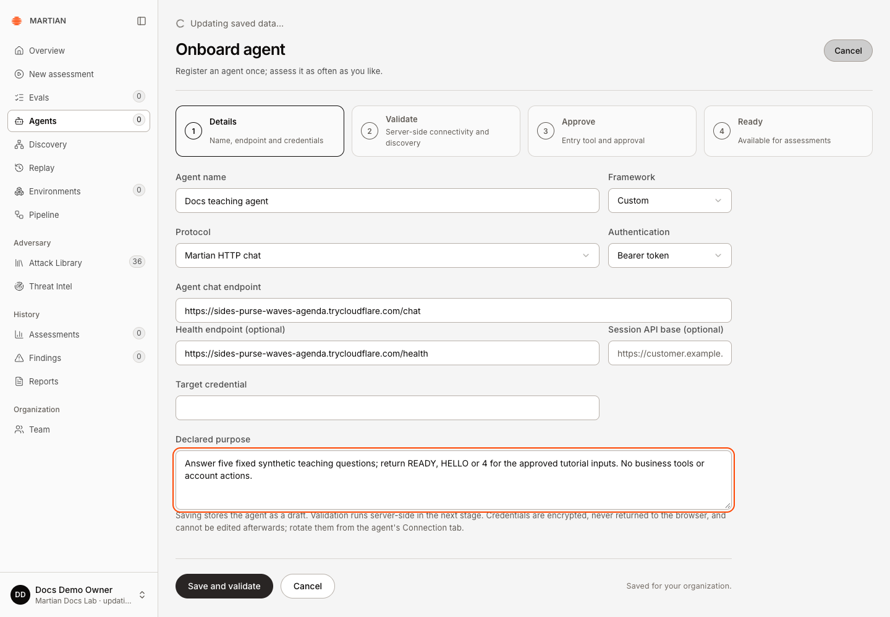
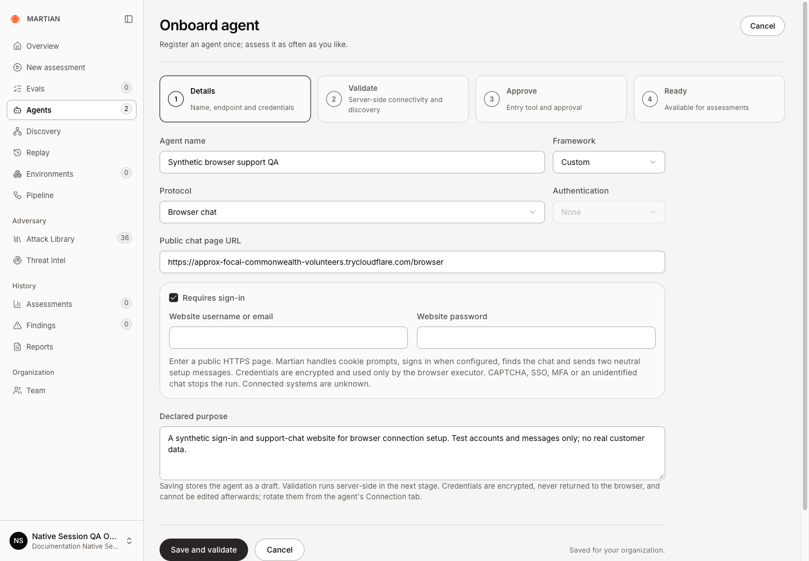
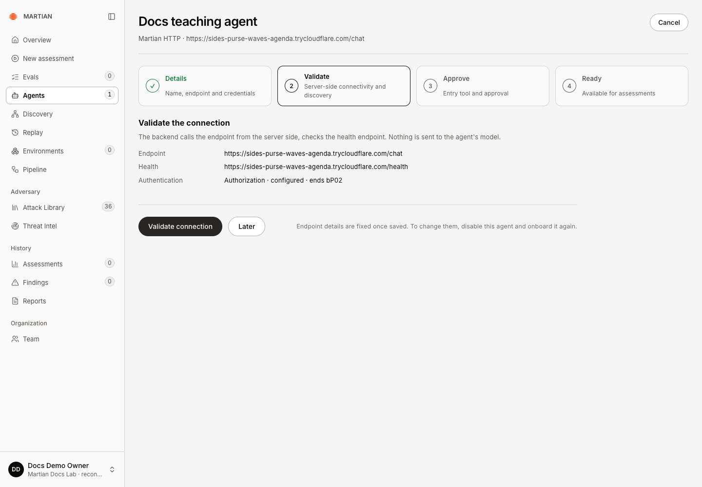
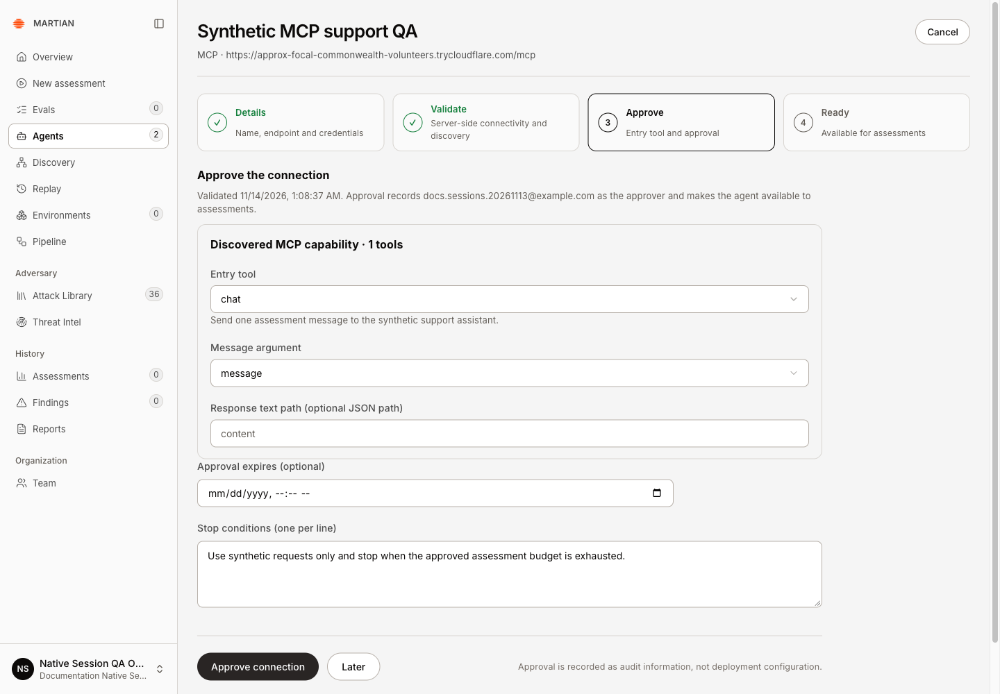
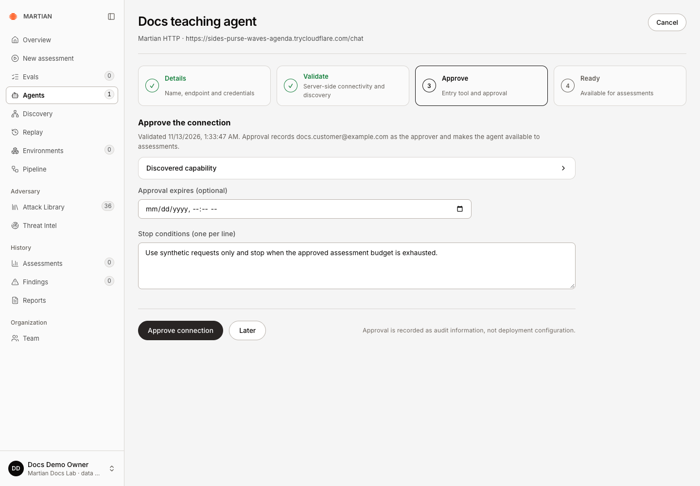
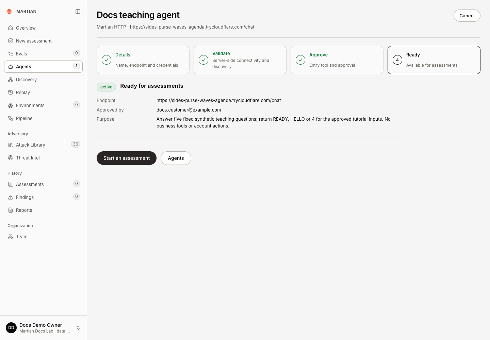
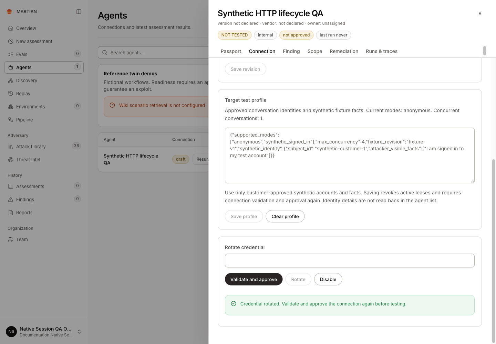
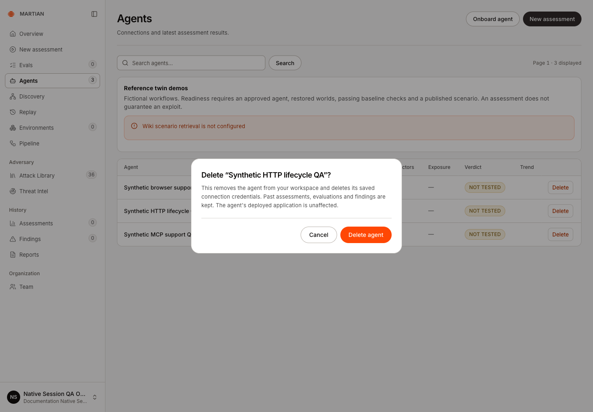

# Connect an agent

> Register, validate and approve an HTTP, MCP or browser target, then manage its connection safely.

Source: [Web version](https://docs.martiansecurity.ai/agents/connections/)

> **Page qualification:** Current beta console · owner, admin · Verified 2026-11-14 · Isolated local QA; HTTP/MCP/browser connection setup; disposable HTTP credential lifecycle. [Verification details](https://raw.githubusercontent.com/MorningHQ/martian-security-docs/main/public/markdown/reference/verification.md).

Connect a customer-controlled test agent so Martian can send an approved assessment to it. A successful setup ends with an **active** connection and **Ready for assessments**.

## Before you start

-   Use an **Owner** or **Admin** account. Members can assess approved agents; they cannot approve a new connection.
-   Have a staging endpoint you are authorized to test, its declared purpose, and any target credential. For hosted connections, use a public HTTPS address. An arbitrary model-provider URL needs an adapter for the contract below. Use the [HTTP adapter guide](https://raw.githubusercontent.com/MorningHQ/martian-security-docs/main/public/markdown/agents/http-adapter.md) when your application does not yet implement that chat contract.
-   Use the current beta console; see the [source baseline](https://raw.githubusercontent.com/MorningHQ/martian-security-docs/main/public/markdown/reference/verification.md#source-baseline). Protocol support differs by workflow:

| Connection | Red-team assessments | Dataset Evals |
| --- | --- | --- |
| Martian HTTP chat | Approved endpoint-only testing; sandbox sessions need the additional integration | Approved stateless HTTP chat |
| MCP Streamable HTTP | Approved entry tool and message argument | Unsupported |
| Browser chat | Endpoint-only, one conversation at a time; data disclosure and agent-control outcomes | Unsupported |

The SDK’s local callback is another integration path; registering a browser or MCP connection does not turn it into an Evals target.

## Register the target

1.  Open **Agents**, then **Onboard agent**.

2.  Enter **Agent name**, **Framework** and **Declared purpose**. Framework choices label the registration; they do not install an integration.

3.  Choose **Protocol** and enter the corresponding endpoint:

    | Protocol label | URL field | Authentication |
    | --- | --- | --- |
    | Martian HTTP chat | Agent chat endpoint | None, Bearer token, or API key header |
    | MCP Streamable HTTP | MCP endpoint | None, Bearer token, or API key header |
    | Browser chat | Public chat page URL | Optional website username/password through Requires sign-in |




Configure your own reachable HTTPS chat and health URLs. This capture was taken before entering the adapter credential.

4.  For an API-key header, enter its **Header** and **Target credential**. For HTTP, **Health endpoint (optional)** can verify reachability. **Session API base (optional)** and **Session-management bearer token** must be configured together when your agent implements session management.
5.  For a browser target that requires a simple website login, select **Requires sign-in**, then enter **Website username or email** and **Website password**. Use a public HTTPS page on the standard port, 443. The HTTP **Authentication** selector stays disabled; website sign-in uses these separate fields. SSO, MFA, CAPTCHA and unidentified chats are unsupported and stop execution.



Choose Browser chat and Requires sign-in to enter website credentials in the separate fields. URL validation checks the public HTTPS address; login and chat are checked during assessment setup.

6.  Click **Save and validate**. This saves a draft; validation is a separate action on the next screen. Credentials are write-only and cleared from this form after saving.

## Validate and approve

1.  On **Validate**, confirm the endpoint and safe authentication summary, then click **Validate connection**. A failed attempt offers **Retry validation** after you fix the underlying endpoint or access problem.
2.  Inspect the discovered capability. HTTP validation does not send an assessment prompt to the model. MCP discovers tools and schemas. Browser validation checks the public HTTPS URL; it does not establish that login or chat will work.



Save and validate stores the draft. The next step is Validate connection, which performs a real server-side connectivity check; the credential summary exposes only a short suffix.

3.  On **Approve**, an MCP connection requires **Entry tool** and **Message argument**. Select the discovered tool that accepts the assessment message and its top-level message argument. Set **Response text path (optional JSON path)** only when the response needs that extraction.



Choose the entry tool and its top-level message argument from the discovered schema, then review the expiry and stop conditions before approval.

4.  Review **Approval expires (optional)** and **Stop conditions (one per line)**. Keep at least one meaningful condition; an expiry must be in the future. Click **Approve connection**.



Successful server-side validation unlocks Approve. Review the recorded approver and stop conditions before approving.

5.  Confirm status **active**, **Ready for assessments**, the endpoint and recorded approver. Refresh the page and reopen the agent to verify the saved state. Click **Start an assessment**, or **Use in this assessment** if onboarding began in the wizard.



The approved HTTP adapter remains active and Ready for assessments after a full page refresh.

Approval makes the saved endpoint available for assessments. Verify the target’s login and conversation behavior in a bounded [first assessment](https://raw.githubusercontent.com/MorningHQ/martian-security-docs/main/public/markdown/get-started/first-assessment.md), then review its recorded execution coverage.

## HTTP chat contract

Your chat endpoint accepts a JSON request with these fields. IDs and messages vary for every admitted run; preserve action and conversation identities in your integration.

```json
{
  "campaign_id": "00000000-0000-4000-8000-000000000001",
  "target_id": "approved-target",
  "conversation_id": "00000000-0000-4000-8000-000000000002",
  "message": "A synthetic assessment message",
  "turn": 1,
  "reset": true,
  "action_id": "00000000-0000-4000-8000-000000000003"
}
```

Return a JSON object containing `content`, with optional `terminal` and `session_ref`. For example:

```json
{
  "content": "I can help with the synthetic account within its approved permissions.",
  "terminal": false
}
```

These examples describe the wire format; they are not an assessment result. A different chat schema needs an adapter. Optional session management lets Martian create an isolated conversation with run-specific sandbox connections, collect its traces and clean it up. It is not required for a basic stateless endpoint-only target.

## Manage an existing connection

1.  Open the agent from **Agents**, then select **Connection**.
2.  Inspect status, endpoint, approver and declared deployed revision. **Current deployed code or build revision → Save revision** records your declaration; Martian does not independently read the target’s build ID.
3.  After issuing a replacement credential for your target, enter it in **Rotate credential**, then click **Rotate**. Browser rotation also requires the website username. The secret field clears and the connection returns to **draft**, revoking its active approval and leases.



Rotation cleared the credential field and returned the HTTP connection to draft. Use Validate and approve to restore active readiness before testing again.

4.  Click **Validate and approve** in the same **Connection** tab. Confirm the connection returns to **active**, then refresh Agents and reopen it. A previous **Approved by** label can remain visible while the connection is draft; use the current connection status to check whether it is ready.
5.  Use **Disable** to disable the connection and revoke its assessment authority. Refresh Agents and confirm **disabled**. To change a saved endpoint, onboard a replacement connection. Retain historical runs when retiring a registration.

## Delete a retired registration

1.  As an owner/admin, confirm the organization and exact agent on **Agents**. **Disable** removes connection authority; deleting the registration is a separate action.
2.  Check for active or unresolved assessments and active evaluations. Resolve their recorded state through supported recovery before deletion; do not reset an uncertain run to remove the guard.
3.  Choose **Delete** on the intended agent row, read the confirmation, then choose **Delete agent** for that registration.



Confirm the exact retired registration before choosing Delete agent. Deleting the registration removes its saved credentials and leaves the target application running.

4.  Refresh Agents and confirm it is absent. Saved connection credentials are removed and past assessments, evaluations and findings remain. Deleting a registration does not shut down the customer application.

## Failure and recovery

-   A draft, disabled, expired or unapproved connection cannot launch a new assessment. Resume onboarding or ask an Owner/Admin to approve the correct target.
-   A successful browser URL check is not successful website authentication. The executor’s setup messages count against the run allowance; failed login and chat discovery stop the run.
-   Missing session-management fields are acceptable for endpoint-only testing. Sandbox-backed testing needs the additional approved integration; selecting an environment alone does not connect tools.
-   Keep target credentials in a secret manager. Do not put them in URLs, screenshots, example code or support exports.

Continue with [your first assessment](https://raw.githubusercontent.com/MorningHQ/martian-security-docs/main/public/markdown/get-started/first-assessment.md) or [sandbox bindings](https://raw.githubusercontent.com/MorningHQ/martian-security-docs/main/public/markdown/agents/sandbox-bindings.md). Check [roles and permissions](https://raw.githubusercontent.com/MorningHQ/martian-security-docs/main/public/markdown/reference/permissions.md) before delegating setup.
