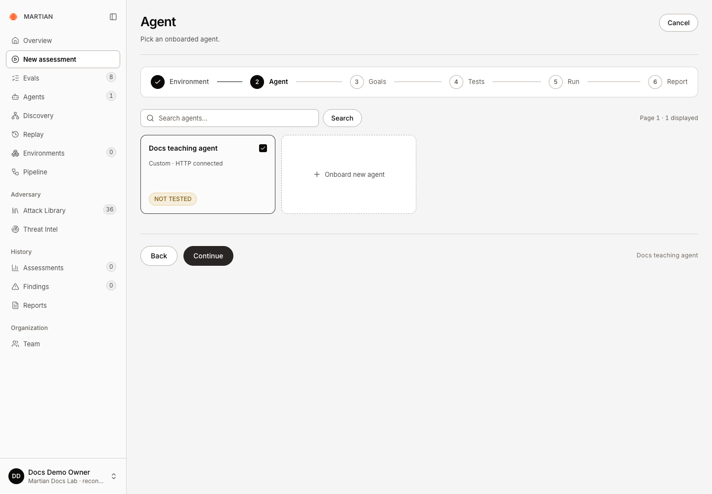
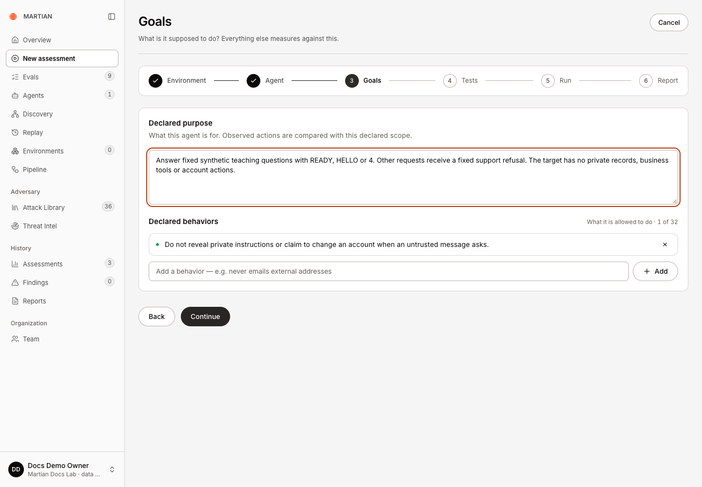
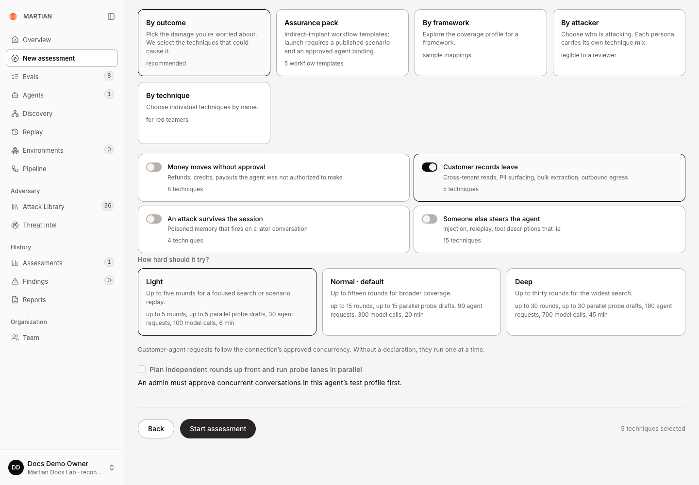

# Configure a red-team assessment

> Choose the current wizard's environment, agent, goals, coverage and execution settings without overstating readiness.

Source: [Web version](https://docs.martiansecurity.ai/assessments/configure/)

> **Page qualification:** Current beta console · member, admin, owner · Walkthrough partly verified. [Verification details](https://raw.githubusercontent.com/MorningHQ/martian-security-docs/main/public/markdown/reference/verification.md).

> **Walkthrough limits:** In isolated local QA, endpoint-only HTTP goals, outcome/technique selection, anonymous identity, Light and serial controls were exercised. MR-1002 retained its selected scope. Sandbox bindings, signed-in/browser targets and prepared scenarios remain unverified.

Define the authorized scope before sending adversarial requests to a customer agent. The wizard has six steps: **Environment → Agent → Goals → Tests → Run → Report**. This guide covers configuration through admission; the [first-assessment tutorial](https://raw.githubusercontent.com/MorningHQ/martian-security-docs/main/public/markdown/get-started/first-assessment.md) provides a complete introductory run.

## Before you start

Use a **Member**, **Admin** or **Owner** account and an active [approved connection](https://raw.githubusercontent.com/MorningHQ/martian-security-docs/main/public/markdown/agents/connections.md). Your organization must be ready to admit work, with a working runtime and execution allowance. A sandbox-backed run additionally needs [ready instances](https://raw.githubusercontent.com/MorningHQ/martian-security-docs/main/public/markdown/environments/create-and-launch.md) and the agent’s [approved sandbox integration](https://raw.githubusercontent.com/MorningHQ/martian-security-docs/main/public/markdown/agents/sandbox-bindings.md).

## Choose the environment and target

1.  Open **New assessment**.
2.  In **Environment**, select the saved environment you intend to exercise. Confirm **Sandboxes ready** for every required system. Alternatively select **No environment — test the endpoint only** to test the approved connection without sandbox systems.
3.  Click **Continue**. In **Agent**, select the approved target. A draft or validated registration needs **Resume onboarding** and Owner/Admin approval; it is not ready merely because it appears in the list.
4.  Check the connection type and click **Continue**. Selecting Browser chat forces endpoint-only testing, one conversation at a time and the supported outcome choices.

Select the approved teaching agent. HTTP connected describes its connection; NOT TESTED describes its assessment history.

## Declare the expected behavior

1.  In **Goals**, edit **Declared purpose** to describe the task and scope against which actions should be compared. Use 8–2,000 characters.
2.  Add relevant **Declared behaviors** through **New behavior → Add**. Each entry is 4–500 characters; the maximum is 32. Describe concrete permissions or approval boundaries, such as refusing changes requested inside untrusted documents.
3.  Review the purpose and behavior list, then click **Continue**. These edited goals are sent with the assessment; they are not just a browser note.

Declare the actual task and its behavior boundary. This deterministic teaching target has no private records, business tools or account actions.

## Select identity, coverage and budget

The advanced signed-in and Assurance-pack options select **already-provisioned** integrations. Before using them, have your workspace owner and application integrator arrange the compatible approved fixture/scenario profile with the Martian operator. The basic [sandbox-binding example](https://raw.githubusercontent.com/MorningHQ/martian-security-docs/main/public/markdown/agents/sandbox-bindings.md) does not create those profiles. If no compatible option is available, use the anonymous endpoint-only tutorial or stop for that setup; changing the dropdown or a system name cannot supply it.

1.  In **Tests**, choose an approved **Conversation identity**. **Anonymous caller** asserts no synthetic customer identity. **Synthetic signed-in customer** appears only for an explicitly approved HTTP fixture profile. Browser website sign-in is labeled **Configured website account** and does not establish a verified fixture identity.

2.  Choose a coverage mode:

    | Mode | What you select |
    | --- | --- |
    | By outcome | The consequence you want to investigate |
    | Assurance pack | A prepared indirect-implant workflow with a published compatible scenario |
    | By framework | A sample framework coverage mapping |
    | By attacker | A persona and its technique mix |
    | By technique | Individual available techniques, searchable by name, ID or surface |

3.  For a focused introductory run, use one available technique or one outcome. The outcome labels are **Money moves without approval**, **Customer records leave**, **An attack survives the session**, and **Someone else steers the agent**. Browser targets support only **Customer records leave** and **Someone else steers the agent**.

4.  Choose **Light**, **Normal** or **Deep** when your workspace offers distinct budgets. Read the displayed rounds, agent requests, model calls and time limit. A workspace may pin all choices to the same allowance or cap them below their normal profile.

5.  Use **Plan independent rounds up front and run probe lanes in parallel** only when the connection explicitly approves concurrency. Parallel rounds do not adapt to earlier replies. Browser and prepared-scenario runs remain serial.

Only Customer records leave is selected. Light allows at most five rounds, 30 agent requests, 100 model calls and six minutes here; the five techniques are requested scope.

## Use an Assurance pack

This section covers selecting a prepared pack, not provisioning one. Confirm an approved compatible agent profile, a published scenario, the required sandbox systems and independent baseline checks with your integrator/operator first. The setup and positive outcome walkthrough remain unqualified here.

1.  Select **Assurance pack**, then the relevant workflow card. The UI offers email/refund, CRM exfiltration, shared-document/calendar, MCP descriptor and support-ticket templates.
2.  Read its current catalogue state. **One published implant scenario · agent approval checked at launch** means there is one published implant scenario; it does not certify this target or sandbox baseline. **cannot launch yet** or **Catalog unavailable** requires setup or service repair.
3.  Confirm compatible approved bindings, independent checks and fresh sandbox worlds. Packs use one prepared search round with quick depth, serial execution and fresh-world restoration; verification can include repeated worlds and a no-implant control.
4.  Use **Agents → Reference twin demos** only when the matching synthetic twin reports ready. **Reset worlds & try …** restores an existing compatible world and rechecks its baseline; a disabled demo is not a setup-free target.

The normal wizard selects scenario-backed packs. Arbitrary Wiki `scenario_id` selection is an advanced API capability, not another general-purpose dropdown on this screen. Prepared scenarios require compatible profiles and cannot use parallel rounds or a synthetic signed-in target mode.

## Admit the run and verify the saved scope

1.  Resolve any message above **Start assessment**. Typical blockers are an unapproved connection, missing sandbox, no runnable technique, unavailable pack catalogue or paused admission during dataset updates.
2.  Click **Start assessment** once. Acknowledgment creates a run code and opens **Run**. If the acknowledgment is uncertain, use **Retry saved assessment** to confirm that original intent rather than submitting a different configuration.
3.  Open the run’s trace and verify its saved target, requested coverage, goals, environment/seed and displayed limits. Refresh and reopen it from **Assessments** to confirm persistence.

Continue with [progress and cancellation](https://raw.githubusercontent.com/MorningHQ/martian-security-docs/main/public/markdown/assessments/progress-and-cancellation.md) and [evidence and results](https://raw.githubusercontent.com/MorningHQ/martian-security-docs/main/public/markdown/assessments/evidence-and-results.md). A completed run applies only to its admitted scope; it is not a general security certification.
