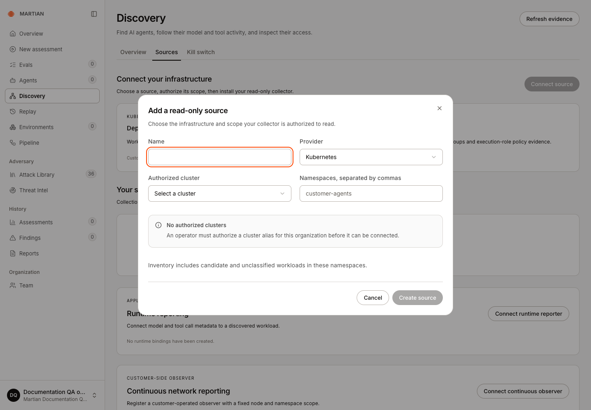

# Connect sources and inspect inventory

> Enroll an authorized read-only source, follow collection status and distinguish observed agents from candidates and supporting workloads.

Source: [Web version](https://docs.martiansecurity.ai/discovery/inventory/)

> **Page qualification:** Current beta console · owner, admin · Walkthrough partly verified. [Verification details](https://raw.githubusercontent.com/MorningHQ/martian-security-docs/main/public/markdown/reference/verification.md).

> **Walkthrough limits:** Own beta QA Owner inspected Connect source/Add a read-only source: no authorized Kubernetes aliases and Create source disabled. Deployment-matched Discovery schema/API/config bytes also expose an incompatibility with the available collector snapshot. Enrollment, real collection, inventory and source lifecycle remain unverified; operator-approved scope and a compatible collector/Backend pair are prerequisites.

Partly verified guide

Collection needs an authorized source and a compatible collector. Enrollment, retained inventory and source lifecycle are still being verified.

Build an inventory from authorized infrastructure evidence and inspect what qualifies each record as an agent, candidate or supporting workload. Enrollment succeeds when the source is saved, its intended collector reports and retained inventory appears with a clear freshness boundary.

## Before you start

Any signed-in tenant user can inspect accessible inventory. **Owner** or **Admin** is required to create/manage sources and reporting bindings. Your operator must authorize the provider scope, such as a Kubernetes cluster alias or named AWS account/regions and read-only role. Customer-side collection requires the actual collector to be installed and running in that authorized environment.

Source collection, runtime reporting and assessment connections have separate credentials and purposes. Creating a source does not start a process or stop an agent.

Check collection readiness first

The beta QA organization shown below has **No authorized clusters**. Its source form was inspected, but enrollment and collection could not be exercised. Ask your operator for an authorized scope and a collector compatible with your deployment before continuing. For this beta QA check, the available collector snapshot and the attested Backend revision have an incompatible Kubernetes observation contract; entering a cluster name cannot resolve that prerequisite.

## Enroll a read-only source

1.  Open **Discovery → Sources** and choose **Connect source** to open **Add a read-only source**.
2.  Select the supported provider and enter its authorized scope. For Kubernetes, choose an authorized cluster and namespaces. For AWS Bedrock, enter the approved account, regions and **Read-only role ARN**. An empty authorized-cluster list needs operator setup first.

This beta QA Owner can inspect the source form, but no cluster alias is authorized. Stop for operator setup; no source or collector credential was created.

3.  Once an authorized scope is available, review it and click **Create source**. If the form says **No authorized clusters**, stop here and request the operator setup; the captured form has **Create source** disabled.

4.  For a customer-side collector, save its once-shown credential privately and **Download scope assignment** or **Download assignment**. The assignment describes scope; the separate credential authenticates the collector. Close the credential panel before making screenshots or sharing the screen.

5.  Install/run the approved collector with that assignment and private credential in its authorized environment. Use the installation package and instructions supplied for your deployment; an enrollment alone is not collection. For hosted collection, the configured hosted reader performs the work.

6.  Inspect **Your sources**, collection mode, collection state, interval and **Last success**. Use **Collect now** only for an enabled, authorized source. It queues the next collector poll; it does not itself collect inventory.

7.  Wait for a distinct collection run and a newer completion / **Last success** time. Inspect its complete, partial or failed coverage and the retained workload identities, then refresh. A queued response or an unchanged old inventory snapshot is not evidence of a new successful collection. If the collector cannot run, fix that prerequisite instead of repeatedly selecting Collect now.

## Review inventory and evidence

1.  Open **Discovery → Overview** and choose **Dashboard source** or all sources.
2.  Inspect the inventory’s agent/candidate view and its evidence labels. **Runtime-observed** requires qualifying trace-correlated model/tool reports; **Provider-listed** identifies a managed agent listed by its provider. Metadata or registration alone remains a candidate.
3.  Use **Search displayed agents** for the loaded page. Check loaded/total counts and pagination; a page search is not a proof that the entire organization has no matching record.
4.  Select a record and inspect its evidence, source freshness and deployment context. **Supporting workloads** are accessed under Sources rather than counted as independently established AI agents.

5.  Continue to **Runtime activity** or **Blast radius** to inspect a selected deployment’s evidence. Infrastructure inventory by itself does not report actual model/tool calls or independently establish effective permission.

## Manage collection and recover

-   **Pause collection** / **Resume collection** changes the reader’s activity. It does not contain the customer’s workload or cancel an assessment.
-   **Replace credential** rotates a customer collector credential. Install the replacement in the intended collector; saving it does not restart that process automatically.
-   A stale or failed source needs its actual reader, authorization and connectivity checked. Do not treat a retained old snapshot as fresh inventory.
-   Revoking a runtime reporter is a different operation from pausing inventory collection. Separate historical identity evidence from recent activity.
-   Network observations do not promote a workload into an agent or prove that every connection succeeded.

Network capture and continuous observers have a separate [setup and lifecycle](https://raw.githubusercontent.com/MorningHQ/martian-security-docs/main/public/markdown/discovery/network-observation.md); inventory-reader credentials do not install node sensors. Continue with [runtime reporting and blast radius](https://raw.githubusercontent.com/MorningHQ/martian-security-docs/main/public/markdown/discovery/runtime-and-blast-radius.md) and [call gates](https://raw.githubusercontent.com/MorningHQ/martian-security-docs/main/public/markdown/discovery/call-gates.md). Review [permissions](https://raw.githubusercontent.com/MorningHQ/martian-security-docs/main/public/markdown/reference/permissions.md) and [limits](https://raw.githubusercontent.com/MorningHQ/martian-security-docs/main/public/markdown/reference/limits.md) before interpreting coverage.
