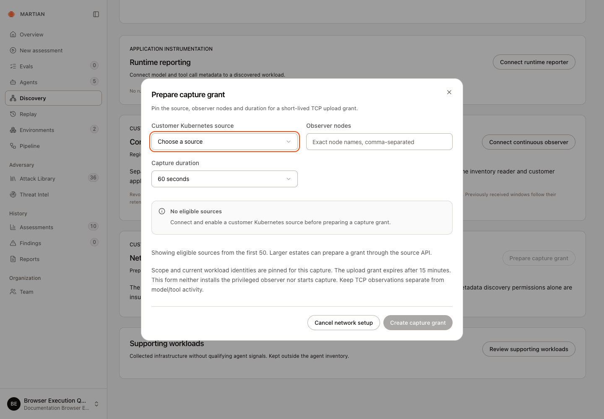
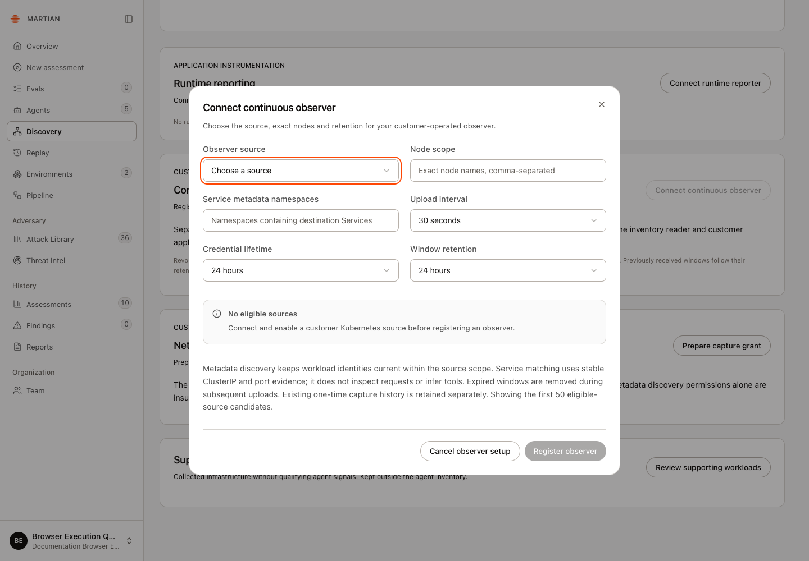

# Set up network observation

> Prepare a short-lived capture grant or enroll a continuous customer observer, then inspect reporting health and evidence limits.

Source: [Web version](https://docs.martiansecurity.ai/discovery/network-observation/)

> **Page qualification:** Current beta console · owner/admin manages; authorized roles read · Walkthrough verification in progress. [Verification details](https://raw.githubusercontent.com/MorningHQ/martian-security-docs/main/public/markdown/reference/verification.md).

> **Walkthrough limits:** Real local Owner inspected the empty-workspace prerequisite screen against the real Backend; observed Discovery GET200 and blocked creation. Full enrollment, instrumentation, execution and required journey captures remain pending.

Guide in progress

Empty-source forms are checked. A compatible authorized source and approved customer-operated sensors are still required for live capture and reporting.

Observe scoped TCP activity from customer-operated Kubernetes sensors. A one-time capture and a continuous observer have separate grants and lifecycles. Neither grants model/tool reporting, blocks calls or activates network isolation.

## Before you start

An **owner/admin** manages grants and observers; authorized customer users inspect retained evidence. First obtain an enabled **customer Kubernetes source**, compatible collected workload identities, exact authorized nodes and a customer cluster operator who can install the approved privileged sensors and observer process.

Inventory read permission does not grant privileged node access. The console does not install or start sensors. Obtain the compatible observer package and installation procedure from your operator; this customer guide covers its console enrollment and evidence checks. The recorded QA source had no authorized cluster, so capture, installation and live reporting remain unqualified.

## 1\. Prepare a one-time capture

1.  Open **Discovery → Sources → Network capture**, then **Prepare capture grant**.
2.  Choose **Customer Kubernetes source** and enter exact comma-separated **Observer nodes**.
3.  Select **Capture duration**: 30 seconds, 60 seconds, 2 minutes or 5 minutes.
4.  Choose **Create capture grant**. This pins scope/current workload identities and prepares an upload grant; it does not start capture.
5.  Save the once-shown **Capture upload credential** privately and use **Download capture assignment**. The assignment excludes the secret. Select **Credential saved** to clear it from the screen.

If no source is listed

**No eligible sources** means you need to [connect and enable a customer Kubernetes source](https://raw.githubusercontent.com/MorningHQ/martian-security-docs/main/public/markdown/discovery/inventory.md) first. Reopen the form after that setup. **Create capture grant** remains disabled while the selector only offers **Choose a source**.

The capture form requires an enabled customer Kubernetes source. This empty workspace cannot create a grant; no credential, sensor or capture was produced.

6.  Have the authorized operator run the scoped observer with that assignment, credential and trusted Backend origin. The upload grant expires after 15 minutes; do not widen scope or change the endpoint to bypass an error.
7.  Ask the operator to return the capture ID and retained result receipt after the observer finishes. An authorized workspace user can retrieve the receipt through `GET /v1/discovery/network-captures/{capture_id}`; the setup form does not open it automatically. Inspect scope, observed time and omission/attribution diagnostics. An issued grant or an empty result is not proof of a successful capture or an idle workload.

**Revoke this upload grant** is available while the once-shown grant panel is open. **Credential saved** clears that panel and its revoke button; retain the capture ID privately. For later revocation, an owner/admin uses the authorized `DELETE /v1/discovery/network-captures/{capture_id}` API or asks the workspace operator to do so. Revocation prevents further uploads. Stop the customer-side capture process through its operator procedure as well; it does not stop customer applications or remove sensors.

## 2\. Connect a continuous observer

1.  Under **Continuous network reporting**, choose **Connect continuous observer**.
2.  Select **Observer source**, enter the exact **Node scope** and **Service metadata namespaces**, then choose **Upload interval**, **Credential lifetime** and **Window retention**.
3.  Choose **Register observer**. Privately save **Observer upload credential**, use **Download observer assignment**, then select **Observer credential saved**.

The continuous observer has the same enabled-source prerequisite. In this empty workspace, **No eligible sources** also leaves **Register observer** disabled; no observer or upload credential has been created.

Continuous reporting also requires an enabled customer Kubernetes source. The visible interval, lifetime and retention choices do not create an observer or install sensors.

4.  Have the operator install/configure the separately approved sensors and customer-run process using that exact assignment. Registration alone does not start them or change workload permissions.
5.  On **Discovery → Overview**, inspect **Where workloads connect** and choose the intended **Observer**. **Manage observer** returns to its registration.
6.  Read last contact, reporting/stale state, credential expiry and the expected reporting interval. Expand **Latest observer health** for each node’s sensor readiness, stream status, input events, omitted events and diagnostics.

7.  Confirm a newly completed window and its sequence/time after the process reports. Refresh and verify retained evidence. A Ready Pod or running process does not establish complete kernel capture.

## 3\. Stop reporting and retain the right evidence

Choose **Revoke observer reporting** for the intended registration when retiring it. New windows are rejected and a connected observer exits at its next request. Stop/remove customer-side processes and node sensors separately through the cluster operator. Existing customer workloads keep running; retained windows follow their retention policy.

## Failures and limits

-   **No eligible sources:** authorize and enable the customer Kubernetes source first. Setup lists the first 50 eligible candidates; do not substitute an unrelated source.
-   **No continuous observer report available / No recent activity window:** check real installation, credential validity, scope and reporting before concluding no activity occurred.
-   Service matching uses collected ClusterIP/port evidence. TCP observation does not identify application requests, infer tools or prove a successful business action.
-   The live view is bounded to 60 windows and 500 connection groups. Read truncation/omission notices and observed time; process restarts can leave gaps. Kernel loss can remain unknown.
-   Credential expiry, retention and last contact are different boundaries. An old retained capture does not establish current reporting health.

Continue with [runtime call metadata](https://raw.githubusercontent.com/MorningHQ/martian-security-docs/main/public/markdown/discovery/runtime-and-blast-radius.md), [inventory collection](https://raw.githubusercontent.com/MorningHQ/martian-security-docs/main/public/markdown/discovery/inventory.md) or [SDK call controls](https://raw.githubusercontent.com/MorningHQ/martian-security-docs/main/public/markdown/discovery/call-gates.md).
