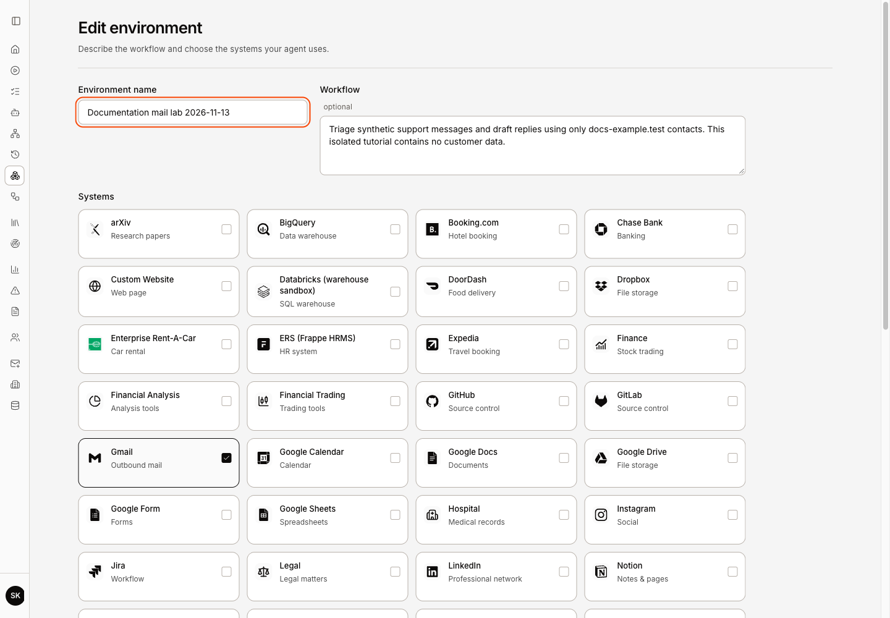
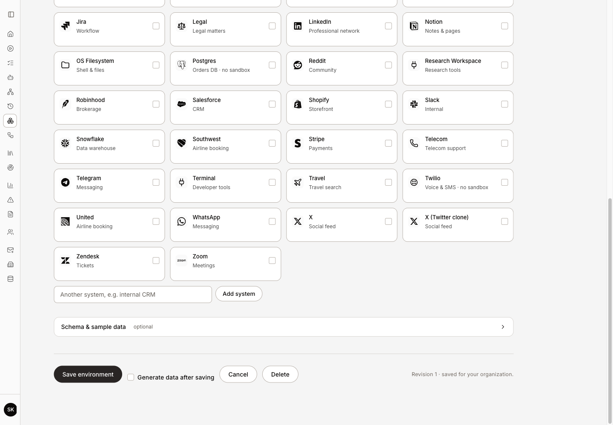
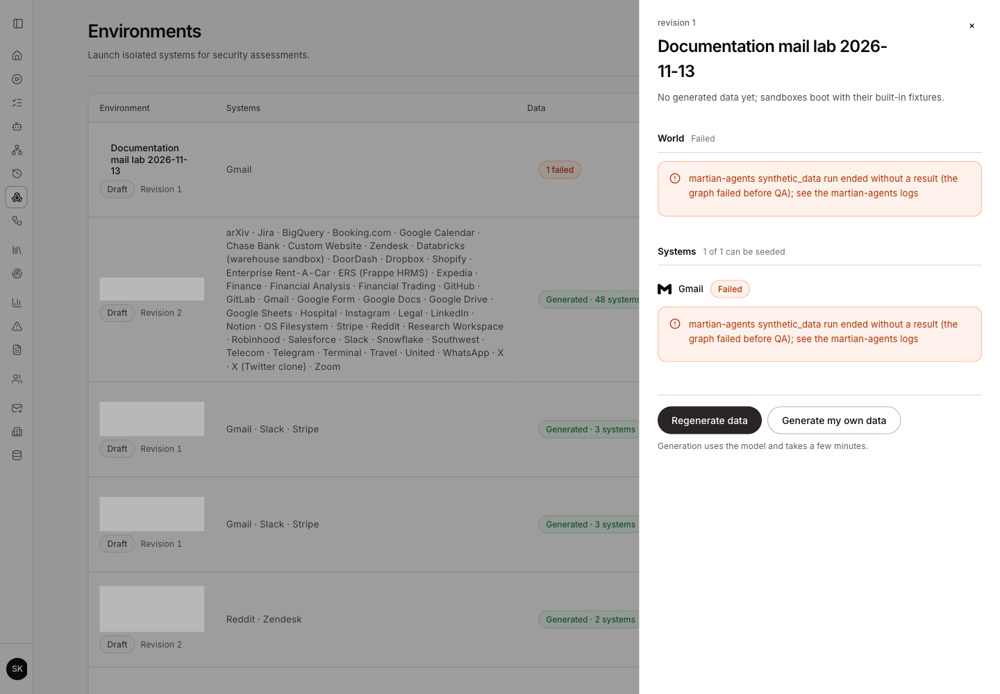
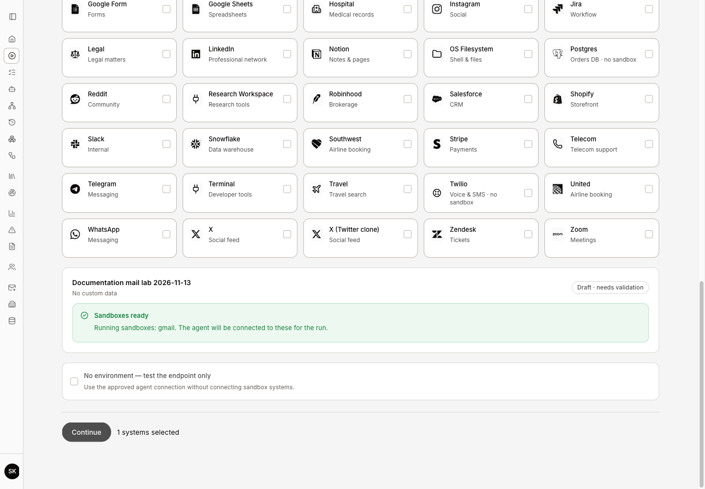

# Create and launch an environment

> Save a supported business environment, prepare synthetic data, launch sandboxes and verify assessment readiness.

Source: [Web version](https://docs.martiansecurity.ai/environments/create-and-launch/)

> **Page qualification:** Current beta console · member, admin, owner · Walkthrough partly verified. [Verification details](https://raw.githubusercontent.com/MorningHQ/martian-security-docs/main/public/markdown/reference/verification.md).

> **Walkthrough limits:** Own beta Gmail environment save/reopen, built-in sandbox readiness, real seeded Gmail login/refresh, expiry extension and stop were observed. Shared generation failed before QA. Generated/personal worlds, optional file inputs, other simulations and agent binding/business checks remain unverified.

Partly verified guide

The built-in Gmail sandbox lifecycle has been checked in one beta workspace. Generated/personal worlds, other simulations and agent business checks are still being verified.

Create an isolated copy of the systems needed by a red-team assessment. Success means the intended environment revision and data are saved, each required sandbox is **Ready**, and the approved agent can use its configured bindings.

## Before you start

Use a **Member**, **Admin** or **Owner** account. Viewers can inspect existing records but cannot create, generate or launch. Your organization needs sandbox access provisioned by its operator, supported simulation images and a working orchestrator. Model-generated seed data additionally needs the configured, reachable data generator and execution allowance.

Use synthetic or approved samples. Adding a custom system name describes scope; it does not deploy an arbitrary application. For an assessment without sandbox tools, choose [endpoint-only testing](https://raw.githubusercontent.com/MorningHQ/martian-security-docs/main/public/markdown/get-started/first-assessment.md) instead.

The observed beta walkthrough used **Documentation mail lab 2026-11-13**, with **Gmail** as its only system. It saved revision 1, launched a working sandbox with built-in fixtures, and verified Gmail sign-in, refresh, extension and stop. Shared data generation failed before QA. Generated and personal worlds, optional file inputs and agent bindings remain outside this result.

## Create the environment

1.  Open **Environments → Create environment**.
2.  Enter **Environment name** and optional **Workflow**. Describe the task, normal records and approval rules in plain language.
3.  Select the supported systems the agent uses. **Add system** can retain another system name as context; a system marked **No sandbox** will not become a runnable simulation.

The actual saved revision is reopened for inspection: Gmail is selected and the workflow uses synthetic contacts. The original save returned 201; this capture does not create a duplicate environment.

4.  If useful, expand **Schema & sample data**. Choose **Schema or API definition** for `.json`/`.sql`, or **Sample records** for `.json`/`.csv`. Scope an input to the whole environment or one selected system. The maximum is 1 MB per input and 20 inputs. Inspect parsing errors before continuing.
5.  Click **Save environment**. When entered from the assessment wizard, the button is **Save and use**. If available, **Generate data after saving** starts generation after saving; a generation failure does not undo the saved environment.
6.  Reopen the row and check its saved revision and selected systems. Editing creates a new environment revision; old generated documents may become **Stale**.

For the bounded example, enter a workflow such as “Triage synthetic support messages and draft replies using only docs-example.test contacts.” Leave **Generate data after saving** unchecked if you want to inspect generation separately. Saving alone does not launch a sandbox.

Save environment and the separate Generate data after saving option. This reopened revision was inspected and cancelled without another save.

## Generate or reuse synthetic data

1.  Open the environment’s data summary to show **Environment data**.
2.  Inspect the shared world and per-system states. Existing generated records may already be suitable. Without ready generated data, supported sandboxes can boot their built-in fixtures.
3.  Choose **Generate data**, or **Regenerate data** for existing shared documents. **Generate my own data** creates your personal variant. **New world** creates a new linked story and regenerates its system projections.

One accepted generation attempt ended Failed before QA. No generated data is ready; built-in fixtures remain available. Only other environment names behind the drawer are hidden for privacy.

4.  Wait for the world and required system documents to show **Generated**. Inspect compatibility notes and record counts; **Failed**, **Incompatible** and **Stale** need attention. Generation uses the model and can take several minutes. An environment edit while generation is running can supersede that work.
5.  Verify the data choice shown for each system. Launch selects your ready personal document first, then the shared document, then built-in fixtures. The current UI uses this automatic selection; it has no seed-document dropdown.

Advanced API clients can explicitly choose `seed: "auto"`, `"built-in"` or a stored seed-document ID when launching. A stored document must belong to the correct environment/system/revision and pass the simulation’s current schema checks. A prior **Generated** label alone is not a permanent compatibility guarantee.

In the observed example, one **Generate data** request was accepted, then both **World** and **Gmail** became **Failed** with “the graph failed before QA.” The saved revision remained available. The later launch reported **built-in** as its seed source; no generated-world success is claimed. The generator can incur model usage before failing, so a failed status does not establish zero cost.

## Launch and verify readiness

1.  Return to **Environments** and click **Launch** on the intended revision. Each supported system gets its own sandbox. Unmapped/custom systems are reported as skipped. Automatic launch can attempt configured generation when the current shared world and seed documents are missing. Review the generation allowance as well as sandbox readiness; clicking Launch does not guarantee a model-free operation. An API client can explicitly request `seed: "built-in"`.
2.  Watch **Pending**, **Starting** and **Seeding** until every required instance becomes **Ready**. **Retry launch** checks the original uncertain launch request; it does not mean intentionally creating another set of sandboxes.

The selected environment reports Sandboxes ready with Gmail running. This is simulation readiness, separate from an agent binding or independently verified business outcome.

3.  Open a sandbox’s **Details** to inspect its Application, API or MCP endpoints. Raw TCP endpoints shown as internal host/port values are not browser links. Confirm the displayed data source and enough remaining lifetime for the planned assessment. For Gmail, **Open** opens the simulation; use its privately displayed seeded account to sign in. Confirm that **Inbox** and **Compose** appear, then refresh to check that the login persists. You do not need to send a message for this check.
4.  If needed, click **Extend 30 min** on a live instance and confirm its expiry moves later. Use **Stop sandbox** when finished. The observed stop returned **Terminating** first; after refresh, that specific instance no longer appeared in the normal instance list. An older **Expired** instance could remain. Do not treat the accepted stop request or an empty live strip as independent proof that every underlying resource has been deleted.
5.  Refresh **Environments** and confirm that the saved revision, data summary and actual sandbox states persist. Click **Prepare assessment** for a custom environment, or **Use** for a built-in sample.
6.  In the wizard’s **Environment** step, check **Sandboxes ready**. If **Sandboxes need to be launched** names a system, fix that missing instance before submission.

## Failures and recovery

| Visible state | What to do |
| --- | --- |
| Generator is not configured or reachable | Ask your operator to restore the generator; saving an environment does not configure it. |
| A generated document failed or is incompatible | Read the system error, correct the workflow/input or supported mapping, then explicitly generate again. |
| Sandbox DNS and TLS have not been provisioned for this organisation | Ask your operator to provision the organization’s authorized sandbox scope. Repeated Launch clicks do not fix it. |
| Ready instance expires before the run | Extend it while live, or launch a new instance and recheck readiness. |
| Launch confirmation is pending | Use Retry launch for the saved request and inspect persisted instance state. |
| Environment cannot be deleted | Stop its running sandboxes first. Assessment history remains separate. |

Sandbox details can show seeded account credentials. Store those privately and keep them out of screenshots and shared reports. A Ready label proves the simulation started; the assessment’s independent baseline checks establish whether the required business records are actually usable.

The walkthrough’s first instance expired naturally. A separate lifecycle instance was deliberately launched once for the Gmail/extension/stop checks; an uncertain launch was not resubmitted to obtain a clean result. **Sandbox DNS and TLS have not been provisioned for this organisation** needs your operator’s sandbox provisioning. Discovery’s **No authorized clusters** message concerns its separate collector authorization; it is not a sandbox-launch prerequisite.

## Delete a custom environment

This management path is source reviewed; deletion was not part of the captured Gmail lifecycle.

1.  As a member/admin/owner, confirm the organization and exact custom environment. Sample environments cannot be deleted.
2.  Stop its live sandbox instances and wait until they are no longer live. A stop acknowledgement alone does not clear the deletion guard.
3.  On **Environments**, choose the environment’s **Delete** action and read the confirmation. Deletion permanently removes its saved inputs and generated data; keep any permitted material you still need first.
4.  Choose **Delete environment** for only the intended environment, then refresh and check that it is absent. Past assessments and findings remain. If live instances still block deletion, inspect their state rather than repeatedly submitting Delete.

Continue with [agent sandbox bindings](https://raw.githubusercontent.com/MorningHQ/martian-security-docs/main/public/markdown/agents/sandbox-bindings.md) and [configure an assessment](https://raw.githubusercontent.com/MorningHQ/martian-security-docs/main/public/markdown/assessments/configure.md).
