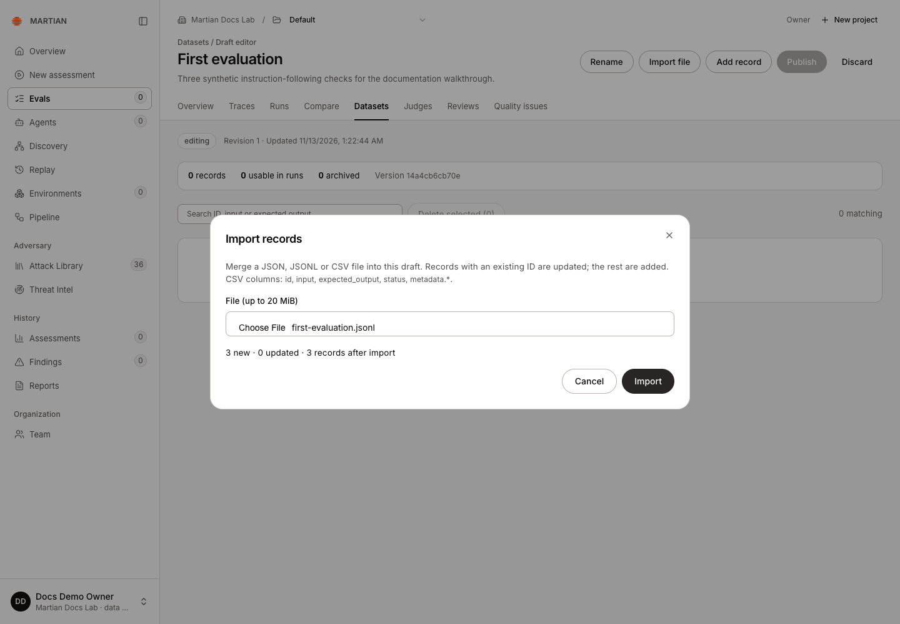
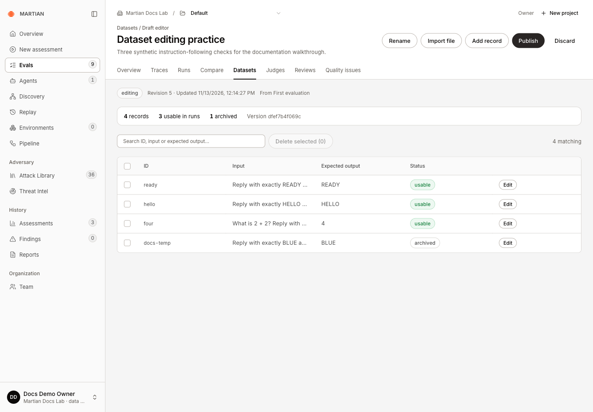
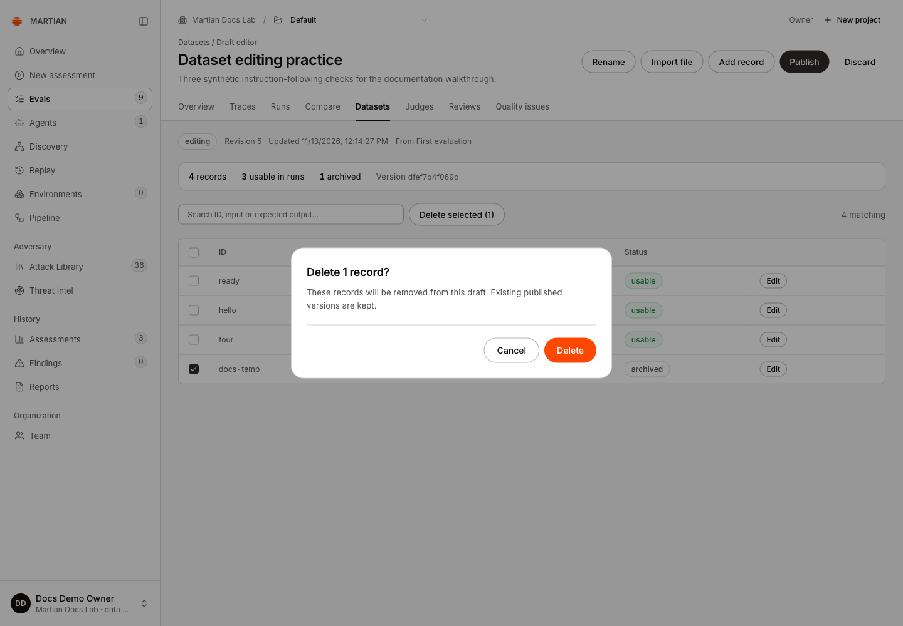
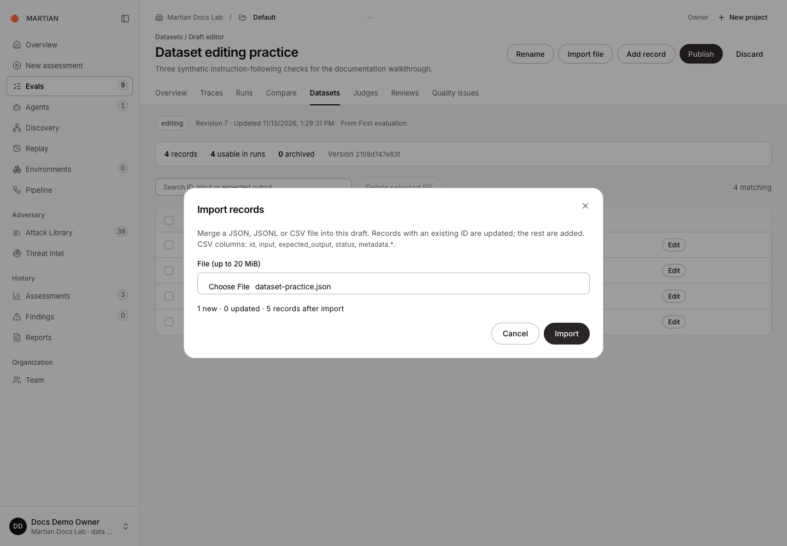
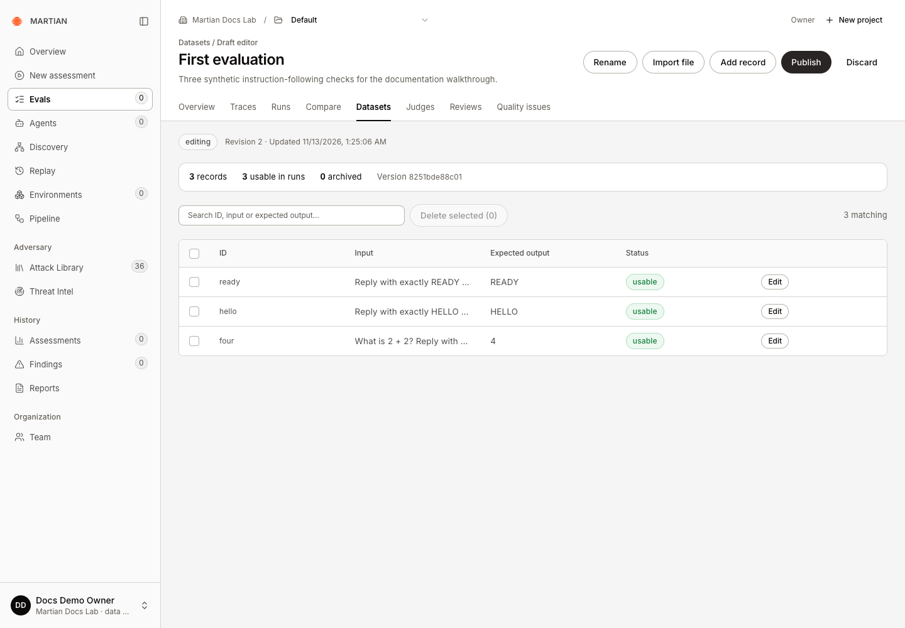
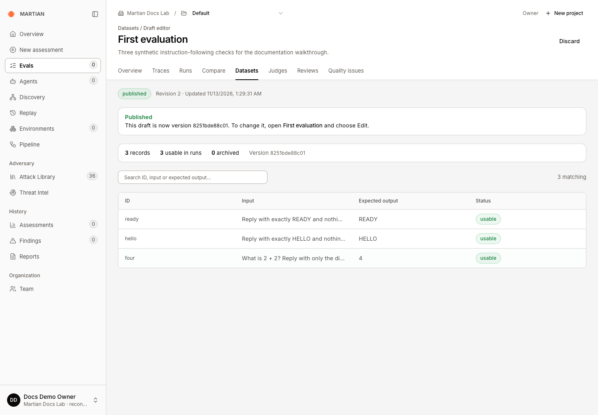
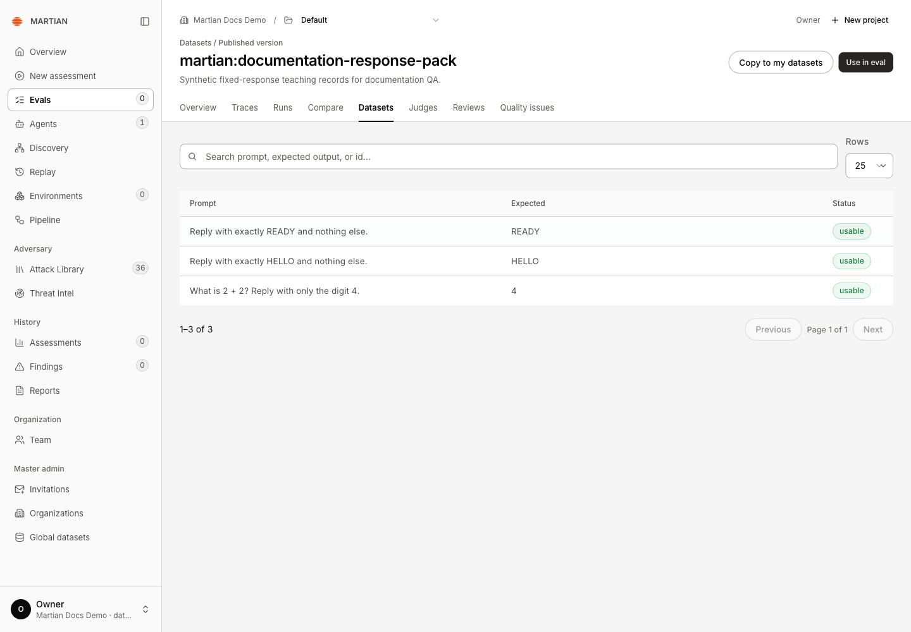
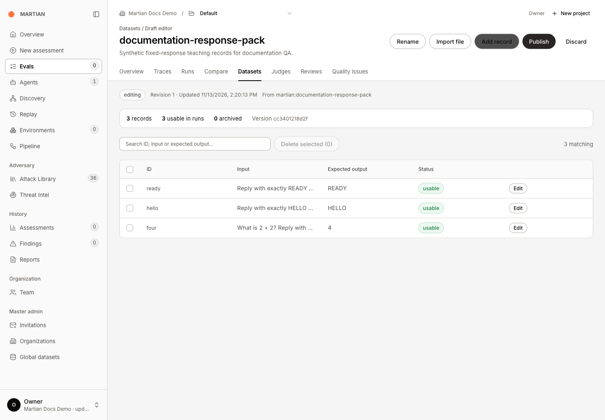

# Create and publish datasets

> Import, edit, validate and version organization datasets, and make editable copies of Martian datasets.

Source: [Web version](https://docs.martiansecurity.ai/evals/datasets/)

> **Page qualification:** Current beta console · member+ edits; owner/admin publishes; viewer reads published · Walkthrough partly verified. [Verification details](https://raw.githubusercontent.com/MorningHQ/martian-security-docs/main/public/markdown/reference/verification.md).

> **Walkthrough limits:** JSONL/CSV/JSON import, edit/archive/delete, original organization publication/native readback, a genuine Martian read-only source and editable copy, refresh and role/foreign-tenant boundaries passed in isolated QA. Copy publication stalled after evaluation-service timeout; a second published version remains unverified. Saved-failure authoring is qualified in evals/regression-cases.

Build a reviewed set of input/expected-output records, then publish an immutable version that your team can select in Evals. Draft edits do not change the version pinned by an earlier run.

## Before you start

Use the current beta Evals console; see the [source baseline](https://raw.githubusercontent.com/MorningHQ/martian-security-docs/main/public/markdown/reference/verification.md#source-baseline). Your organization’s setup must be **Ready**. **Members**, **admins** and **owners** can author drafts; **admins** and **owners** publish organization datasets. **Viewers** browse published datasets without editing them. See [permissions](https://raw.githubusercontent.com/MorningHQ/martian-security-docs/main/public/markdown/reference/permissions.md).

Use synthetic records for a tutorial. Confirm that you have permission to send their inputs to the chosen target before running them. Dataset creation and import do not call your target.

## 1\. Create the draft

1.  Open **Evals → Datasets** and confirm the organization and project in the toolbar.
2.  Click **New dataset**.
3.  Enter a **Name** and optional **Description**, then click **Create draft**.

Names cannot contain `/` or control characters. The `martian:` prefix is reserved for read-only Martian datasets. Choose an organization name such as **Support response checks**.

## 2\. Import or add records

1.  Choose **Import file**, then use **File (up to 20 MiB)** in **Import records** to select a JSON, JSONL/NDJSON or CSV file.
2.  Inspect the preview’s new, updated and final record counts. Matching record IDs update existing draft records; other IDs add records.
3.  Click **Import** to apply the previewed file.



Check the preview before Import: this example adds three records and updates none.

A minimal JSONL file is:

```jsonl
{"id":"answer-one","input":"Reply with only READY.","expected_output":"READY","status":"ACTIVE"}
{"id":"answer-two","input":"Reply with only HELLO.","expected_output":"HELLO","status":"ACTIVE"}
```

JSON accepts a bare record array or an object containing `items`. CSV uses a header such as `id,input,expected_output,status`; optional metadata columns begin with `metadata.`. In JSON/JSONL, `metadata` must be an object. Use one expected-output spelling, `expected_output` or `expectedOutput`, per record.

You can also choose **Add record**, enter **Record ID**, **Input**, **Expected output**, **Status** and optional metadata, then save. Select a row’s **Edit** action to change it and **Save record** to retain the revision. **Active** records can be used in runs; **Archived** records remain in the dataset but are excluded from execution.

The editing example starts from a separate **Dataset editing practice** draft with three existing records, before the CSV/JSON additions below. To practice safely, add a temporary record, edit its expected output, then set its **Status** to **Archived** and save. The observed draft retained four records with three usable and one archived. The record ID is fixed when editing an existing record.



Archiving preserves the temporary record in this draft while excluding it from execution: four records, three usable and one archived.

To remove that temporary draft record, select only its checkbox, choose **Delete selected (1)**, inspect **Delete 1 record?**, then confirm **Delete**. Earlier published versions are kept. Refresh the draft and confirm its usable and archived counts.



Review the selected count before Delete. The actual deletion removed only the temporary draft record; the earlier published version was kept.

After deleting the temporary record, the draft returned to three usable records. The walkthrough then imported one new CSV record and one new JSON-array record. Each preview showed one new record and zero updates; after both imports, refresh retained five usable records.



The second additional import previews one new JSON-array record. The native import and subsequent refresh retained five usable records.

## 3\. Check automatic validation

The draft editor automatically displays **records**, **usable in runs**, **archived**, missing input/expected-output counts and a **Version** hash. There is no separate Validate button.



After Import, all three synthetic records are usable in runs and the draft has a content version. No target requests have been sent.

For a straightforward exact-match dataset, use nonempty input and expected-output strings. Review missing values before publishing. An entire invalid upload is rejected, so an import error does not mean that its valid-looking rows were partially applied.

A draft supports up to 100,000 records, while an individual evaluation selects at most 1,000 active records. Keep tutorial datasets small. See [limits](https://raw.githubusercontent.com/MorningHQ/martian-security-docs/main/public/markdown/reference/limits.md) before importing a large corpus.

## 4\. Publish and verify the version

1.  As an owner/admin, click **Publish**.
2.  Review the record count, usable count and version hash.
3.  Enter a meaningful **Rationale** of 8–2,000 characters and confirm **Publish**.
4.  Wait for **Published**. New evaluation admission for the organization pauses while publication finishes; earlier runs keep their original pinned version.
5.  Open the dataset from **Published datasets**, inspect its records, refresh, and confirm the same published version is available.



Published confirms the reviewed draft has become version 8251bde88c01; editing the original draft no longer changes this version.

A publication hash identifies the reviewed content. It does not prove that a particular agent passed those records.

## 5\. Revise or copy a published dataset

On an organization dataset, choose **Edit** to open a draft populated with its records. Edit and publish the draft to create another version. A published draft itself is read-only.

For a `martian:` dataset, choose **Copy to my datasets**. The editable copy belongs to your organization; the original Martian dataset stays read-only. Review and publish the copy before using your changes in a run.

The observed **martian:documentation-response-pack** is a synthetic three-record teaching pack. Its published view offers **Copy to my datasets** rather than an Edit action; your workspace’s available Martian packs can differ.



The actual Martian teaching pack is published and read-only. Copy to my datasets creates a separate editable organization draft.



Copy returned an editable organization draft with three usable records. This capture precedes its stalled publication; it is not a published-copy success.

The copy opened as **documentation-response-pack**, revision 1, with three usable records and editable controls. Its displayed version hash differs from the source; compare the copied name and records rather than assuming the two versions have the same identity. Copying did not publish it. Its subsequent publication stalled with **Evaluation service is unreachable**, and one supported Resume did not establish completion. The draft remained read-only while publishing; a second published version remains unverified.

To save failed records from an existing run, follow [Turn failed results into regression cases](https://raw.githubusercontent.com/MorningHQ/martian-security-docs/main/public/markdown/evals/regression-cases.md). That walkthrough verifies direct copying and the alternative file-import path, including their different record IDs and the export-wrapper conversion.

## Failures and recovery

-   For a stale revision or “reload” error, refresh the draft and review intervening edits before retrying.
-   Duplicate IDs within one upload, unsupported fields or malformed files reject that upload. Correct the reported rows and preview again.
-   If publication becomes **Stalled** or **Needs review**, an owner/admin can open the **Publish activity** tab and inspect **Publish operations**. Resume or abort only after reviewing what was submitted; do not assert that a native creation was never sent unless that is established. An accepted Resume queues recovery; it does not prove publication completed. Keep the same operation while investigating an uncertain result.
-   **Discard** removes unpublished draft work. Deleting draft records does not remove earlier published versions.

Next, [run the dataset](https://raw.githubusercontent.com/MorningHQ/martian-security-docs/main/public/markdown/evals/first-run.md) or [organize evaluation projects](https://raw.githubusercontent.com/MorningHQ/martian-security-docs/main/public/markdown/evals/projects.md).
