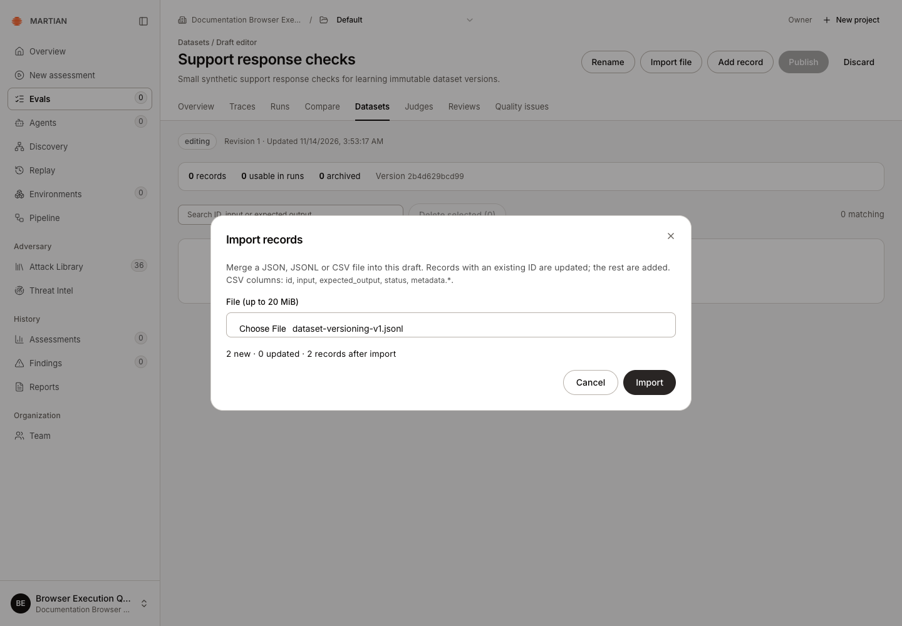
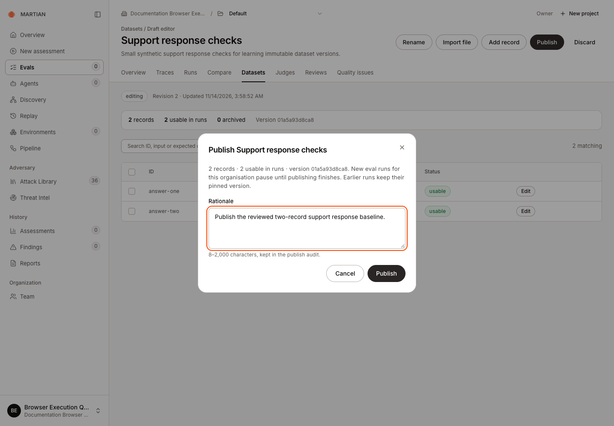
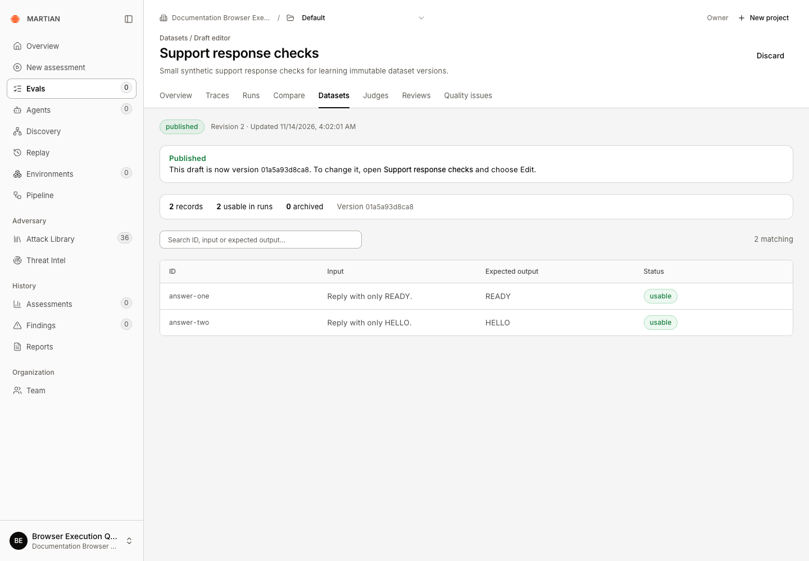
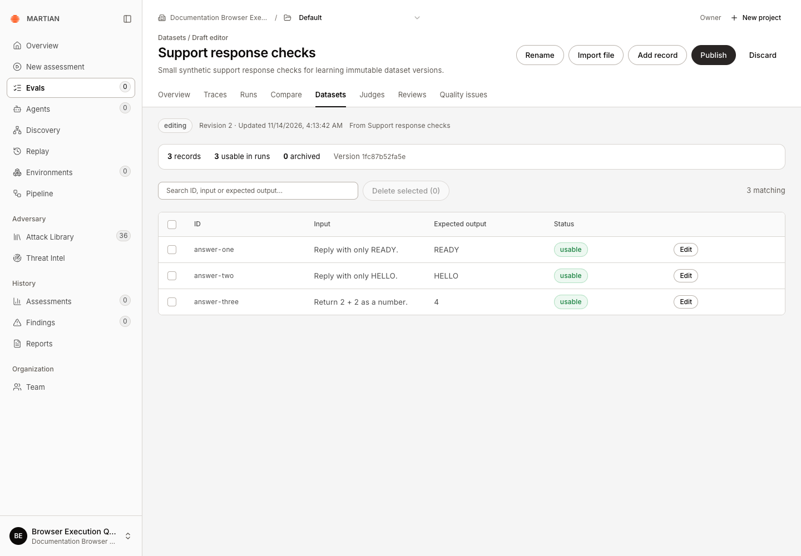
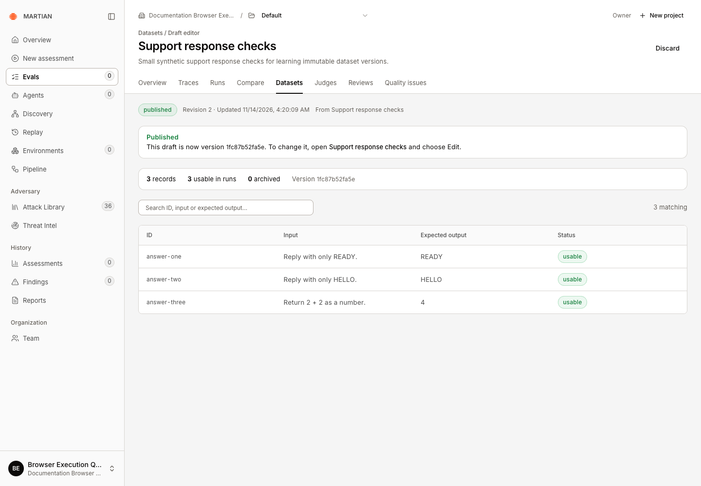
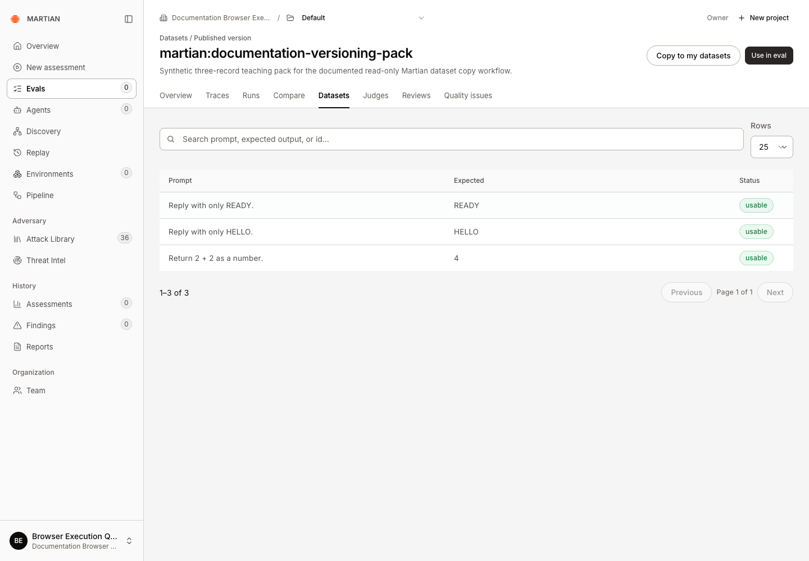
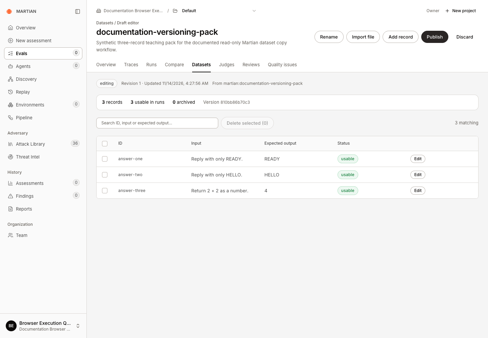
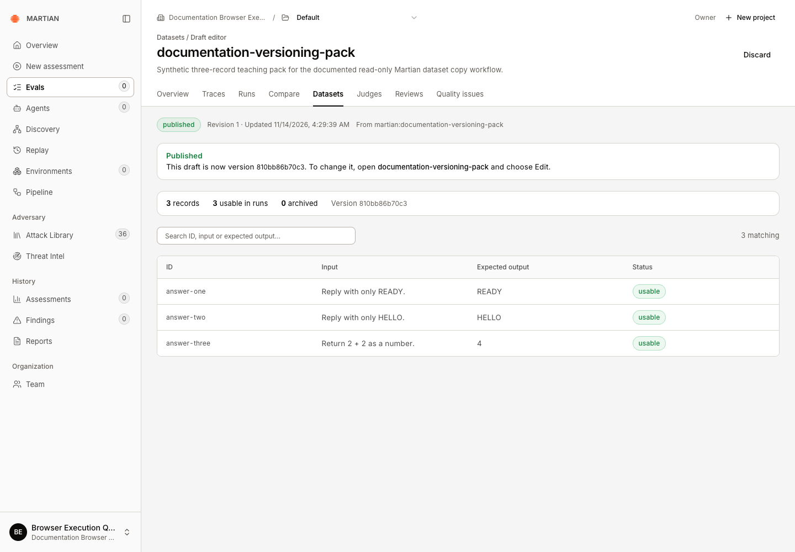
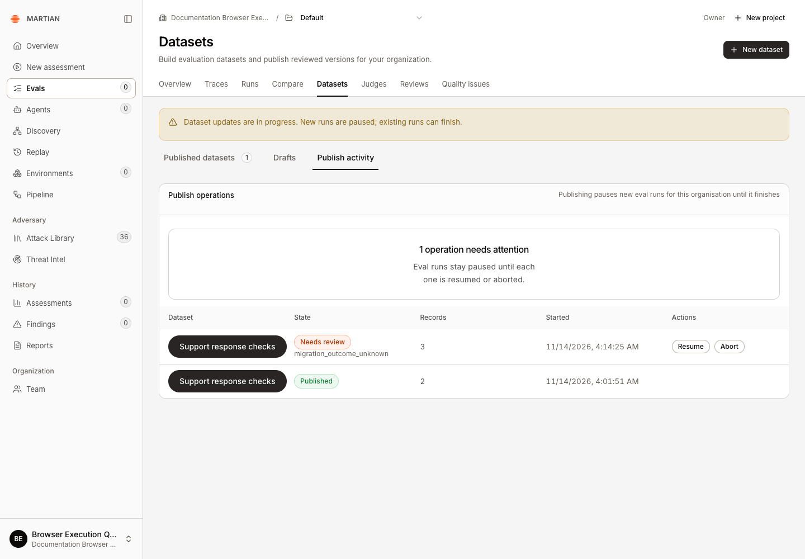

# Create and publish datasets

> Import, edit, validate and version organization datasets, and make editable copies of Martian datasets.

Source: [Web version](https://docs.martiansecurity.ai/evals/datasets/)

> **Page qualification:** Current beta console · member+ edits; owner/admin publishes; viewer reads published · Verified 2026-11-14 · Isolated local QA; original JSONL/CSV/JSON editing and role boundaries in Martian Docs Lab; separate immutable-version and Martian-copy publication in Documentation Browser Execution QA; pinned source baseline. [Verification details](https://raw.githubusercontent.com/MorningHQ/martian-security-docs/main/public/markdown/reference/verification.md).

Build a reviewed set of input/expected-output records, then publish an immutable version that your team can select in Evals. Draft edits do not change the version pinned by an earlier run.

## Before you start

Use the current beta Evals console; see the [source baseline](https://raw.githubusercontent.com/MorningHQ/martian-security-docs/main/public/markdown/reference/verification.md#source-baseline). Your organization’s setup must be **Ready**. **Members**, **admins** and **owners** can author drafts; **admins** and **owners** publish organization datasets. **Viewers** browse published datasets without editing them. See [permissions](https://raw.githubusercontent.com/MorningHQ/martian-security-docs/main/public/markdown/reference/permissions.md).

Use synthetic records for a tutorial. Confirm that you have permission to send their inputs to the chosen target before running them. Dataset creation and import do not call your target.

## 1\. Create the draft

1.  Open **Evals → Datasets** and confirm the organization and project in the toolbar.
2.  Click **New dataset**.
3.  Enter a **Name** and optional **Description**, then click **Create draft**.

Names cannot contain `/` or control characters. The `martian:` prefix is reserved for read-only Martian datasets. Choose an organization name such as **Support response checks**.

## 2\. Import or add records

Save this two-record example as `support-response-checks.jsonl`:

```jsonl
{"id":"answer-one","input":"Reply with only READY.","expected_output":"READY","status":"ACTIVE"}
{"id":"answer-two","input":"Reply with only HELLO.","expected_output":"HELLO","status":"ACTIVE"}
```

1.  Choose **Import file**, then use **File (up to 20 MiB)** in **Import records** to select the file.
2.  Confirm **2 new · 0 updated · 2 records after import**. Matching record IDs update existing draft records; other IDs add records.
3.  Click **Import** to apply the previewed file.



Confirm two new records and zero updates before Import. This preview matches the two-line JSONL example.

JSON and CSV are also supported; see [more editing and import options](https://raw.githubusercontent.com/MorningHQ/martian-security-docs/main/public/markdown/evals/datasets.md#more-editing-and-import-options) below.

## 3\. Check automatic validation

After importing this example, confirm **2 records**, **2 usable in runs** and **0 archived**. The draft editor automatically displays these counts, missing input/expected-output counts and a **Version** hash. There is no separate Validate button.

For a straightforward exact-match dataset, use nonempty input and expected-output strings. Review missing values before publishing. An entire invalid upload is rejected, so an import error does not mean that its valid-looking rows were partially applied.

A draft supports up to 100,000 records, while an individual evaluation selects at most 1,000 active records. Keep tutorial datasets small. See [limits](https://raw.githubusercontent.com/MorningHQ/martian-security-docs/main/public/markdown/reference/limits.md) before importing a large corpus.

Your version hash depends on the dataset name, description and records. It does not need to match the example screenshots.

## 4\. Publish and verify the version

1.  As an owner/admin, click **Publish**.
2.  Review **2 records**, **2 usable in runs** and the version hash.
3.  Enter a meaningful **Rationale** of 8–2,000 characters and confirm **Publish**.



Review the usable count and version, then enter a rationale before confirming Publish.

4.  Wait for **Published**. New evaluation admission for the organization pauses while publication finishes; earlier runs keep their original pinned version.
5.  Open the dataset from **Published datasets**, inspect its records, refresh, and confirm the same published version is available.



Published confirms the first two-record version. Refresh retained READY, HELLO and the same version hash.

A publication hash identifies the reviewed content. It does not prove that a particular agent passed those records.

## 5\. Publish a revised version

1.  Open **Support response checks** from **Published datasets**, then choose **Edit**. This creates a separate draft populated with the two published records. A published draft itself is read-only.

2.  Choose **Add record** and enter the following values, leaving optional metadata empty:

    | Field | Value |
    | --- | --- |
    | Record ID | `answer-three` |
    | Input | `Return 2 + 2 as a number.` |
    | Expected output | `4` |
    | Status | **Active** |

3.  Confirm **Add record**. Check **3 records**, **3 usable in runs**, **0 archived** and a changed **Version**.




Check the new draft before publishing: three usable records and a changed content version. The earlier published version is kept.

4.  Publish this draft with a rationale describing the added case, then wait for **Published**.
5.  Reopen **Support response checks** from **Published datasets** and refresh. It now contains all three records and the revised version.



The revised version is Published with three records after refresh. The original two-record native version remained unchanged.

The observed example changed from two-record version `01a5a93d8ca8` to three-record version `1fc87b52fa5e`. The original published draft and its two native records remained unchanged. The catalog opens the current version; there is no older-version selector on this screen.

The revised publication initially reached **Needs review** after a service timeout. One supported **Resume** of the same operation completed it; see [publication recovery](https://raw.githubusercontent.com/MorningHQ/martian-security-docs/main/public/markdown/evals/datasets.md#publication-recovery). The first submission alone was not treated as success.

## 6\. Copy a Martian dataset

1.  Open a `martian:` dataset from **Published datasets**. It offers **Copy to my datasets** instead of **Edit**.

Your workspace’s available Martian packs can differ. The examples use synthetic teaching records, not a security benchmark.



This synthetic Martian pack is read-only. Copy to my datasets creates an editable organization draft; your available packs may differ.

2.  Choose **Copy to my datasets**. The editable organization draft opens with the reserved `martian:` prefix removed from its name. Check its copied records before making changes.



Copy removes the reserved prefix and opens an editable three-record draft. Publication is still required.

3.  Review the automatic validation summary, choose **Publish**, enter a rationale and confirm. Wait for **Published**.
4.  Reopen your copy from **Published datasets** and refresh. Confirm its records and organization ownership. Reopening the original Martian dataset still shows the read-only source.



The organization copy is Published and survives refresh. Its separate native identity preserves the original read-only Martian pack.

The observed **martian:documentation-versioning-pack** became the separately published **documentation-versioning-pack**, with three usable records. Its version differs from the source: a copy has its own identity. The original Martian dataset retained the same records and version. Copying alone does not publish a draft.

To save failed records from an existing run, follow [Turn failed results into regression cases](https://raw.githubusercontent.com/MorningHQ/martian-security-docs/main/public/markdown/evals/regression-cases.md). That walkthrough verifies direct copying and the alternative file-import path, including their different record IDs and the export-wrapper conversion.

## More editing and import options

Edit, archive, delete, or import JSON and CSV

Choose **Add record** to enter **Record ID**, **Input**, **Expected output**, **Status** and optional metadata manually. Select a row’s **Edit** action and **Save record** to change an existing record. The record ID is fixed when editing. **Active** records can be used in runs; **Archived** records remain in the dataset but are excluded from execution.

This separate **Dataset editing practice** example starts with three records. A temporary record was added, edited and archived, leaving four records with three usable and one archived.


Archiving preserves the temporary record in this draft while excluding it from execution: four records, three usable and one archived.

To remove the temporary record, select only its checkbox, choose **Delete selected (1)**, inspect **Delete 1 record?**, then confirm **Delete**. Earlier published versions are kept.


Review the selected count before Delete. The actual deletion removed only the temporary draft record; the earlier published version was kept.

After deletion, the draft returned to three usable records. One new CSV record and one new JSON-array record were then imported. Each preview showed one new record and zero updates; refresh retained five usable records after both imports.


The second additional import previews one new JSON-array record. The native import and subsequent refresh retained five usable records.

JSON accepts a bare record array or an object containing `items`. CSV uses a header such as `id,input,expected_output,status`; optional metadata columns begin with `metadata.`. In JSON/JSONL, `metadata` must be an object. Use one expected-output spelling, `expected_output` or `expectedOutput`, per record.

## Failures and recovery

-   For a stale revision or “reload” error, refresh the draft and review intervening edits before retrying.
-   Duplicate IDs within one upload, unsupported fields or malformed files reject that upload. Correct the reported rows and preview again.
-   **Discard** removes unpublished draft work. Deleting draft records does not remove earlier published versions.

### Publication recovery

If publication becomes **Stalled** or **Needs review**, open **Datasets → Publish activity** as an owner/admin and find the original row in **Publish operations**. New runs remain paused until the operation finishes or is aborted.



This initial interruption kept the earlier two-record version published. Resume later completed the same three-record operation without asserting that native creation was never submitted.

Choose **Resume**, enter a rationale and continue from the saved checkpoints. Leave the assertion that an interrupted creation was **never submitted** unchecked unless that has been independently proven. Ask your workspace administrator or support for help when native submission is uncertain.

Wait for Published

An accepted **Resume** queues recovery. Wait for **Published**, then reopen and refresh the dataset to verify its records. Keep the original operation while investigating an uncertain result; creating another publication does not resolve it.

The observed three-record revision completed through this path. **Abort** discards the unpublished version, keeps the current published version and makes its draft editable again; that abort path was not exercised for this example.

Next, [run the dataset](https://raw.githubusercontent.com/MorningHQ/martian-security-docs/main/public/markdown/evals/first-run.md) or [organize evaluation projects](https://raw.githubusercontent.com/MorningHQ/martian-security-docs/main/public/markdown/evals/projects.md).
