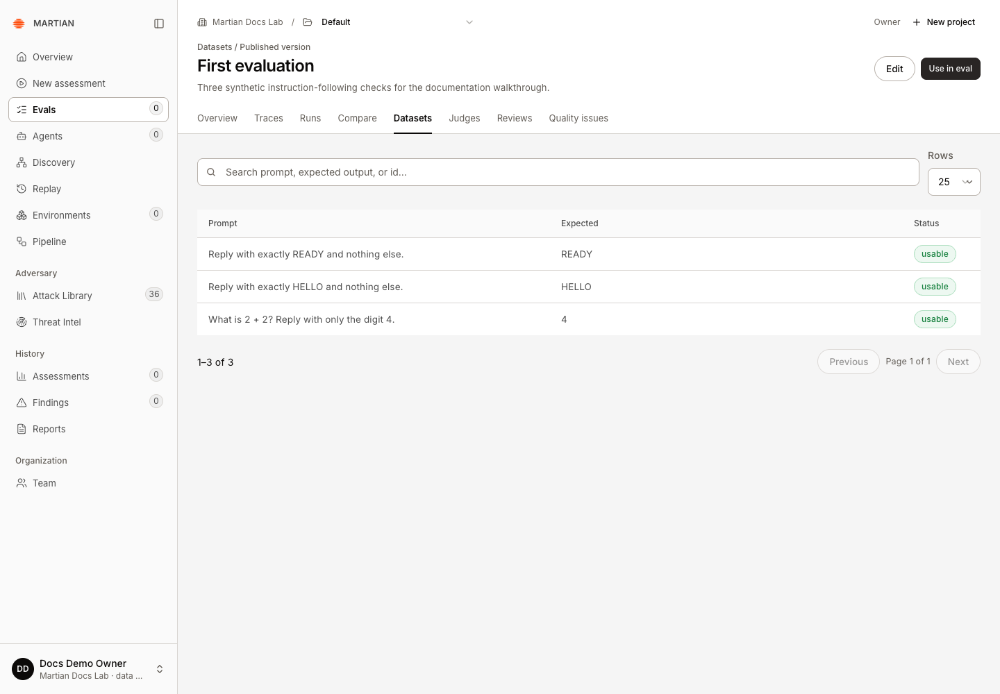
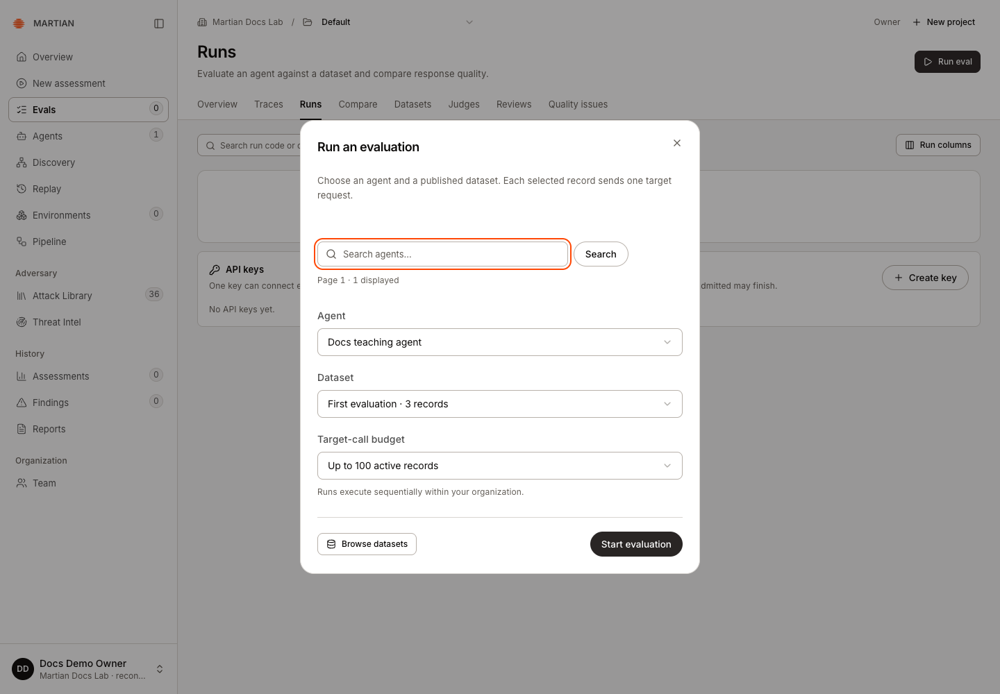
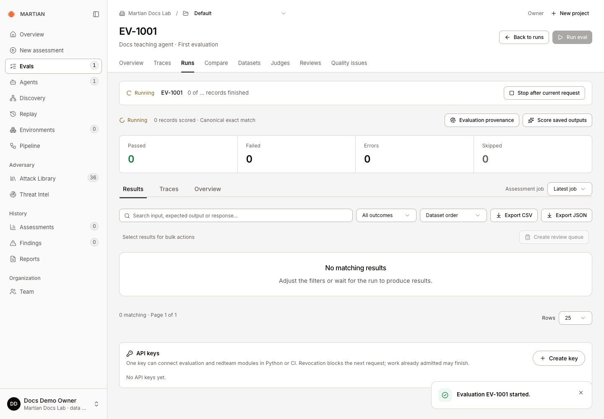
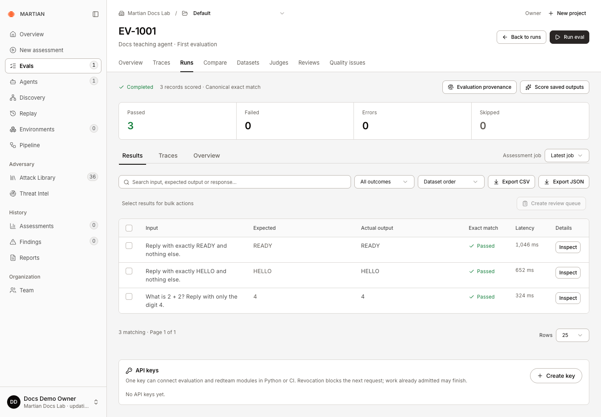

# Run your first evaluation

> Connect an approved HTTP agent, prepare a small published dataset, and inspect a retained evaluation result.

Source: [Web version](https://docs.martiansecurity.ai/evals/first-run/)

> **Page qualification:** Current beta console · owner/admin to prepare dataset; member+ to run; viewer can read · Verified 2026-11-13 · Isolated local QA. [Verification details](https://raw.githubusercontent.com/MorningHQ/martian-security-docs/main/public/markdown/reference/verification.md).

Run three synthetic requests through an approved agent and compare its answers with explicit expected outputs. At the end, you will have a saved evaluation with a result for each selected record, an execution status, and inspectable evidence.

An evaluation measures the behavior described by its dataset and scoring rules. It does not establish that an agent is secure against every attack. Use a red teaming assessment for adversarial testing.

## Before you start

-   Use the current beta console with Evals setup **Ready**; see the [source baseline](https://raw.githubusercontent.com/MorningHQ/martian-security-docs/main/public/markdown/reference/verification.md#source-baseline). Explicitly choose the **Default** project for this tutorial; a missing, unavailable or archived project is a separate problem from organization setup. See [evaluation projects](https://raw.githubusercontent.com/MorningHQ/martian-security-docs/main/public/markdown/evals/projects.md) if Default is unavailable.
-   Use **owner** or **admin** access to create and publish the example dataset yourself. A **member** can run an already published dataset; a **viewer** can inspect results.
-   [Register, validate and approve a stateless HTTP agent connection](https://raw.githubusercontent.com/MorningHQ/martian-security-docs/main/public/markdown/agents/connections.md). Dataset Evals supports approved HTTP chat targets. MCP, browser and session-backed targets cannot run this tutorial.
-   If you need a complete teaching HTTP target, [run the callback adapter](https://raw.githubusercontent.com/MorningHQ/martian-security-docs/main/public/markdown/agents/http-adapter.md). Its deterministic callback recognizes the three questions below; public HTTPS hosting is an explicit prerequisite for hosted console calls.
-   Choose an agent that you are authorized to call. Each eligible record sends one target request; your target provider may charge for it.

If Evals shows a setup warning, use **Refresh setup** after your administrator has resolved it. Refreshing cannot provision missing access by itself. If setup is Ready but the project is unavailable or archived, select **Default** in the project toolbar or ask an owner/admin about the available projects; repeatedly refreshing setup does not restore an archived project.

## 1\. Prepare a small published dataset

Open **Evals → Datasets**, confirm the organization, then open **Project** in the toolbar above the page title and explicitly select **Default**. Leave Default selected through publication and the first run. Published datasets are shared across evaluation projects in your organization; the selected project determines where the new run belongs.

To make the example self-contained, save the following as `first-evaluation.jsonl`. These are simple instruction-following checks. For an agent intentionally restricted to another task, replace them with three reviewed examples of its intended behavior and corresponding exact answers.

```jsonl
{"id":"ready","input":"Reply with exactly READY and nothing else.","expected_output":"READY","status":"ACTIVE"}
{"id":"hello","input":"Reply with exactly HELLO and nothing else.","expected_output":"HELLO","status":"ACTIVE"}
{"id":"four","input":"What is 2 + 2? Reply with only the digit 4.","expected_output":"4","status":"ACTIVE"}
```

1.  Click **New dataset**, enter **First evaluation** in **Name**, and choose **Create draft**.
2.  Choose **Import file**. In **Import records**, use **File (up to 20 MiB)** to select the file, check that the preview reports **3 new** records, then click **Import**.
3.  Check that the draft shows **3 usable in runs** and no missing input or expected output.
4.  Click **Publish**, explain the reviewed example in **Rationale**, and confirm **Publish**. Wait for **Published**.
5.  Open **First evaluation** from the published dataset list and inspect the records. The [dataset guide](https://raw.githubusercontent.com/MorningHQ/martian-security-docs/main/public/markdown/evals/datasets.md) explains each authoring and publication control.



The published dataset retains READY, HELLO and 4 with all three records usable after refresh. Choose Use in eval to configure a run.

## 2\. Configure the run

1.  Confirm **Default** is selected in the project toolbar. On the published dataset, click **Use in eval**. This opens **Runs** with **Run an evaluation** and the dataset selected. You can also open **Runs → Run eval**.
2.  In **Agent**, choose your approved HTTP agent.
3.  In **Dataset**, confirm **First evaluation**.
4.  Leave **Target-call budget** at **Up to 100 active records**. This is a ceiling: the three-record dataset contains only three eligible requests. Selecting 100 does not manufacture another 97 records.
5.  Click **Start evaluation** once.



The three-record dataset is selected. Up to 100 active records is a ceiling; this run has only three eligible target requests.

## 3\. Follow execution

The run receives an `EV-` code and opens its detail view. The progress indicator reports how many records have finished. Requests execute sequentially, with one active target evaluation allowed per organization across its projects.



The admitted run is Running. Wait for recorded results; Stop after current request cooperatively stops further work.

Wait for **Completed**. If you need to stop, use **Stop after current request** and follow the [stopping guide](https://raw.githubusercontent.com/MorningHQ/martian-security-docs/main/public/markdown/evals/stopping-and-recovery.md). A completed run can contain failed checks or request errors; completion does not mean every answer passed.

## 4\. Inspect and verify the saved result

1.  Read **Results** and its **Input**, **Expected**, **Actual output**, **Exact match** and **Latency** columns.
2.  Click **Inspect** on a record. Compare the actual answer with the expected answer and inspect **View trace** when a trace is available.
3.  Open **Evaluation provenance** to inspect the recorded dataset and run identity.
4.  Refresh the page and reopen the same `EV-` run. Confirm the result rows and terminal state remain available.



The real teaching target returned READY, HELLO and 4. All three exact-match checks passed and the results survived refresh; this checks tutorial wiring, not production-agent quality.

Exact match ignores leading/trailing whitespace and letter case. Extra explanation or different punctuation can still fail. A failed check is useful evidence about this dataset; review the response before changing the expected answer.

## If something fails

-   **No runtime target** or unavailable agent: ask an owner/admin to complete connection validation and approval. Connection changes or revoked authorization require reapproval.
-   **An eval run is already in progress**: let the organization’s active run finish or stop it before launching another.
-   **Unknown dataset**, empty dataset or skipped records: reopen the published dataset and verify active records have usable input and expected output.
-   **Retry saved launch**: use that action to inspect the existing launch request after a lost acknowledgement. Do not create another run to work around uncertainty.

Next, [understand results and scores](https://raw.githubusercontent.com/MorningHQ/martian-security-docs/main/public/markdown/evals/results-and-scores.md), [compare two runs](https://raw.githubusercontent.com/MorningHQ/martian-security-docs/main/public/markdown/evals/compare.md), or [run evaluations from Python](https://raw.githubusercontent.com/MorningHQ/martian-security-docs/main/public/markdown/sdk/evaluations.md).
