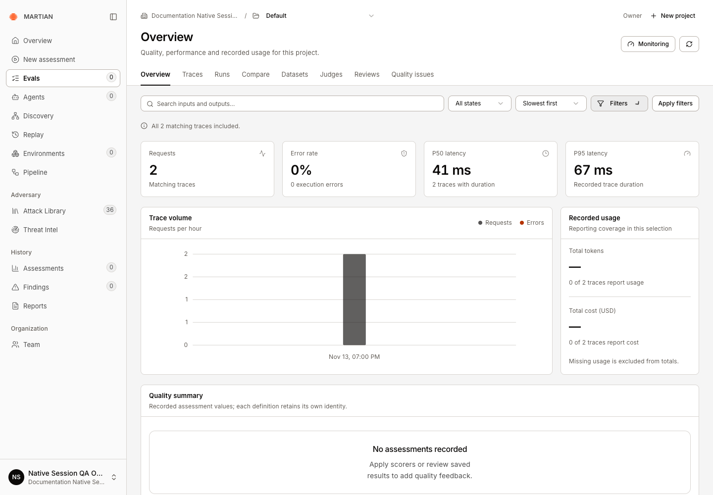
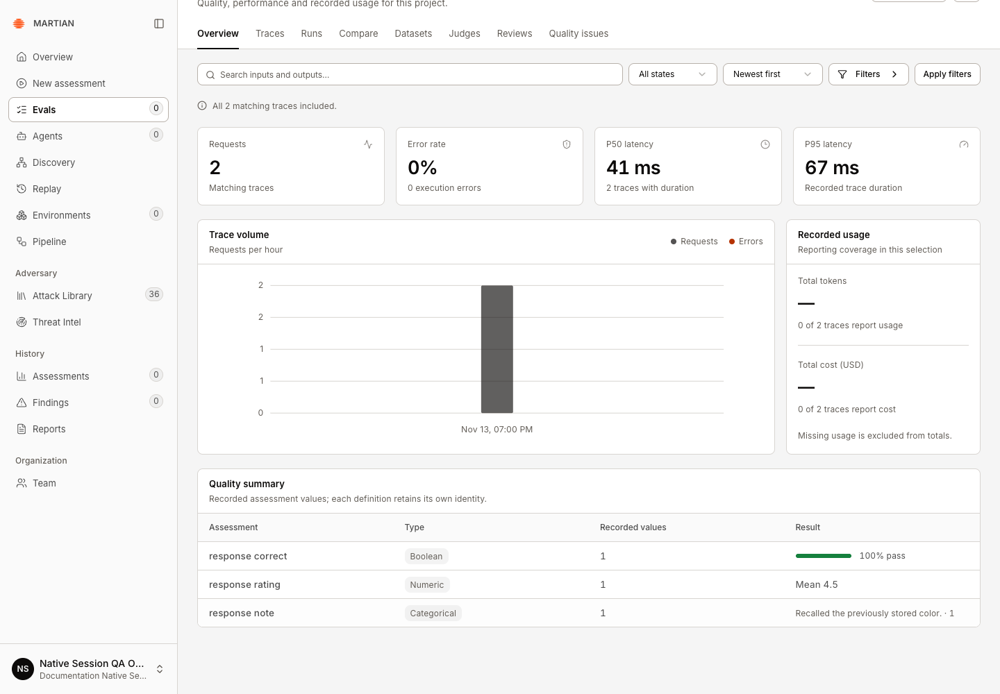

# Read the Evals dashboard

> Interpret project trace volume, errors, latency, recorded usage and typed quality summaries without rerunning a target.

Source: [Web version](https://docs.martiansecurity.ai/evals/overview/)

> **Page qualification:** Current beta console · Any customer role · Verified 2026-11-13 · Isolated local QA; native traces. [Verification details](https://raw.githubusercontent.com/MorningHQ/martian-security-docs/main/public/markdown/reference/verification.md).

Use the project dashboard to understand the native traces retained for your selected scope. It summarizes recorded activity; it does not launch an evaluation or schedule model calls.

## Before you start

Any customer role can read authorized evidence. Choose a ready Evals project with retained native traces. This is **Evals → Overview**, distinct from an individual evaluation run’s Overview tab and from saved-score Monitoring.

The screenshots use the two retained requests from the [native conversation walkthrough](https://raw.githubusercontent.com/MorningHQ/martian-security-docs/main/public/markdown/evals/traces-and-sessions.md#3-group-recorded-conversations). You can use any authorized traces in your selected project; opening this dashboard does not call the agent again.

## 1\. Choose the trace selection

1.  Open **Evals → Overview** and confirm the organization and **Project**.
2.  Use **Search trace content**, **Trace state** and **Trace order** to select the activity you need.
3.  Open **Filters** (accessible name **More filters**) for session, user, time, latency or assessment criteria.
4.  Choose **Apply filters**. Read the applied scope and incomplete-coverage notice before interpreting totals. **Refresh overview** rereads the selection.

The two retained HTTP traces are included. The dashboard reports zero execution errors, P50 41 ms and P95 67 ms; usage remains unavailable.

## 2\. Read performance and usage

| Metric | Meaning |
| --- | --- |
| Requests | Matching recorded native traces, rather than a count of every provider call or evaluation case |
| Error rate | The share with recorded ERROR trace state; a failed quality check is a separate result |
| P50 / P95 latency | Percentiles of reported trace durations |
| Trace volume | Recorded activity over time; it is not a future execution schedule |
| Total tokens / Total cost (USD) | Reported usage in the matching traces, accompanied by reporting coverage |

1.  In **Recorded usage**, check how many traces reported tokens and cost.
2.  Treat missing reports as unavailable. No reported bill is not an independently established zero bill; partial coverage is not total provider spend.
3.  Check the selected time window and coverage again before comparing two selections.

Neither trace reports tokens or cost. Three saved feedback definitions produce their own typed summaries; the separate expectation is excluded.

## 3\. Interpret Quality summary

1.  Read **Assessment**, **Type**, **Recorded values** and **Result** together.
2.  Boolean feedback can show pass rates. Numeric feedback can show means. Categorical/text values retain their recorded-value counts rather than becoming pass percentages.
3.  [Inspect the underlying traces](https://raw.githubusercontent.com/MorningHQ/martian-security-docs/main/public/markdown/evals/traces-and-sessions.md) when a summary needs explanation. Use [native annotations](https://raw.githubusercontent.com/MorningHQ/martian-security-docs/main/public/markdown/evals/trace-annotations.md) when you intend to add a human opinion or expectation.

For example, feedback named `response_correct` appears as **response correct**. A single Pass gives **100% pass** for that one recorded judgment; a numeric rating of `4.5` gives **Mean 4.5**. Text feedback appears as **Categorical**, with the text and its count. These examples describe the saved opinions, rather than independently verifying the response.

These are native feedback aggregates. They do not replace canonical exact-match results, a versioned suite gate or verified security outcomes. For gate history, choose **Monitoring** and follow [suites and monitoring](https://raw.githubusercontent.com/MorningHQ/martian-security-docs/main/public/markdown/evals/suites-and-monitoring.md).

## Failures and limits

-   Aggregates inspect at most 1,000 matching traces. Narrow the selection when coverage is incomplete; do not describe a bounded sample as all history.
-   After a read error, use **Refresh overview** and retain the scope/error if it persists. Reading the dashboard does not repair missing instrumentation.
-   An empty selection can mean missing telemetry or restrictive filters. It does not establish that the application made no requests.

Continue with [trace inspection](https://raw.githubusercontent.com/MorningHQ/martian-security-docs/main/public/markdown/evals/traces-and-sessions.md) or [individual run results](https://raw.githubusercontent.com/MorningHQ/martian-security-docs/main/public/markdown/evals/results-and-scores.md).
