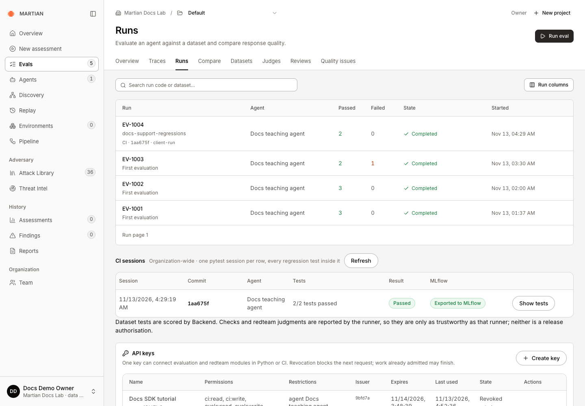
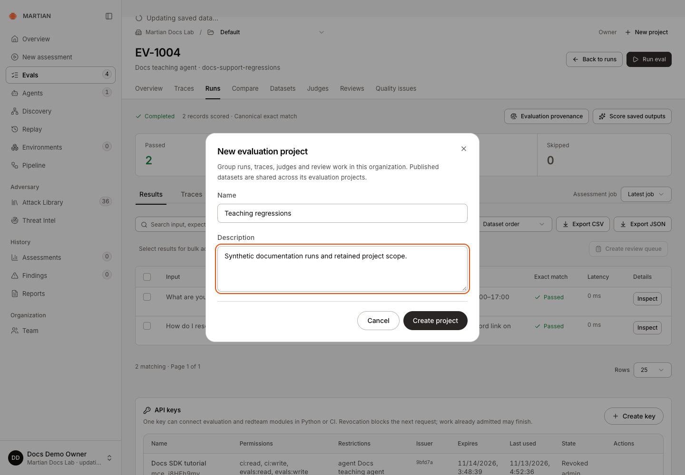
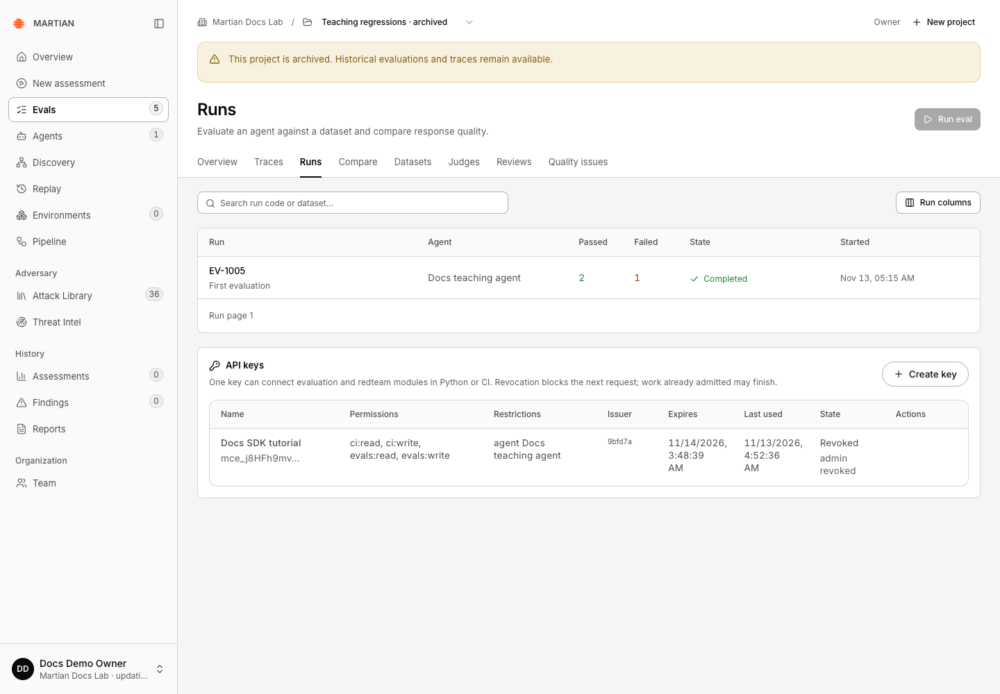

# Organize evaluation projects

> Select, create and archive projects while preserving organization boundaries and historical evaluation evidence.

Source: [Web version](https://docs.martiansecurity.ai/evals/projects/)

> **Page qualification:** Current beta console · owner/admin creates/archives; all customer roles browse · Verified 2026-11-13 · Isolated local QA. [Verification details](https://raw.githubusercontent.com/MorningHQ/martian-security-docs/main/public/markdown/reference/verification.md).

Use projects to group evaluation runs, traces, judge definitions and review work inside your organization. The project selector determines the context for the Evals page you are viewing. Published datasets are shared across the organization’s projects.

## Before you start

Use an organization with ready Evals setup in the current beta console. Any customer role can browse authorized projects. Creating or archiving a project requires **owner** or **admin** access. A project is an evaluation grouping, not another organization or a permission grant to a different tenant.

To verify run history in the new project, have an approved agent and a small published dataset ready. Complete the setup in [your first evaluation](https://raw.githubusercontent.com/MorningHQ/martian-security-docs/main/public/markdown/evals/first-run.md) if these are missing.

## 1\. Select a project

1.  Open **Evals** and locate the organization/project toolbar above the page title.
2.  Check the organization name and your role.
3.  Open **Project** and choose **Default** or a named ready project.
4.  Move between **Runs**, **Traces** and other Evals sections. The selected project remains part of that navigation.

The Project control selects the evaluation context. Default shows the earlier runs; the separate Teaching regressions project retained EV-1005.

Runs and trace views are project scoped. Datasets remain available across projects in the same organization. Selecting another project does not copy datasets or give you access to another organization.

## 2\. Create a project

1.  As an owner/admin, click **New project**.
2.  In **New evaluation project**, enter a **Name** and optional **Description** that describe the evaluation work.
3.  Click **Create project** once.
4.  Wait for the new project to appear selected in the toolbar. Open **Runs** to begin work in it.

Enter a name and description, then create the project once. This capture is the reviewed form before submission; the actual request created a ready project.

Creating a project establishes its evaluation context; it does not call an agent or run a model judge. If setup returns an unresolved response, use **Retry project setup** to inspect the saved setup request rather than creating an identically named replacement.

## 3\. Verify retained scope

1.  Refresh the page and confirm the named project is still selected.
2.  If the project is empty, click **Run eval** and follow [Configure the run](https://raw.githubusercontent.com/MorningHQ/martian-security-docs/main/public/markdown/evals/first-run.md#2-configure-the-run), keeping your new project selected instead of Default. Use the approved agent and small published dataset prepared above, then wait for the admitted run to finish.
3.  Open that run and confirm its run code and dataset identity.
4.  Change to **Default** and check that the project-specific run list changes.
5.  Return to the named project and confirm its saved work remains available.

An empty project list can reflect unavailable Evals setup, not an absence of permission to the whole console. Use **Refresh setup** after the underlying issue has been resolved. A URL naming an unavailable project is not sufficient to grant access.

## 4\. Archive a finished project

Archiving is an administrative terminal state in the current console: there is no restore interface. Use it only when the team is finished admitting new work to that project.

1.  Select a custom ready project. The Default context does not expose the same archive action.
2.  Wait for its active target evaluation or scoring work to finish.
3.  Choose the toolbar’s **Archive project** action.
4.  Read **Archive project?** and confirm **Archive project**.
5.  Verify the archived-project warning and refresh. Historical runs and traces remain readable, while new evaluation work is disabled for that project.

After archiving and a full refresh, the historical run remains readable and Run eval is disabled. The example retains a changed-callback run with two passes and one failure; archiving does not rescore it. There is no restore interface.

## Failures and limits

-   A project whose state is not ready cannot admit new evaluation work.
-   Active target or scoring jobs can prevent archiving. Let them finish or use their documented cooperative stop controls before retrying.
-   Archiving does not delete historical evidence or revoke an agent connection. Manage connections through [Agents](https://raw.githubusercontent.com/MorningHQ/martian-security-docs/main/public/markdown/agents/connections.md).
-   Organization-wide concurrency still applies across projects: creating projects does not create extra target-run capacity.

Next, [run an evaluation](https://raw.githubusercontent.com/MorningHQ/martian-security-docs/main/public/markdown/evals/first-run.md) or [inspect traces and sessions](https://raw.githubusercontent.com/MorningHQ/martian-security-docs/main/public/markdown/evals/traces-and-sessions.md).
