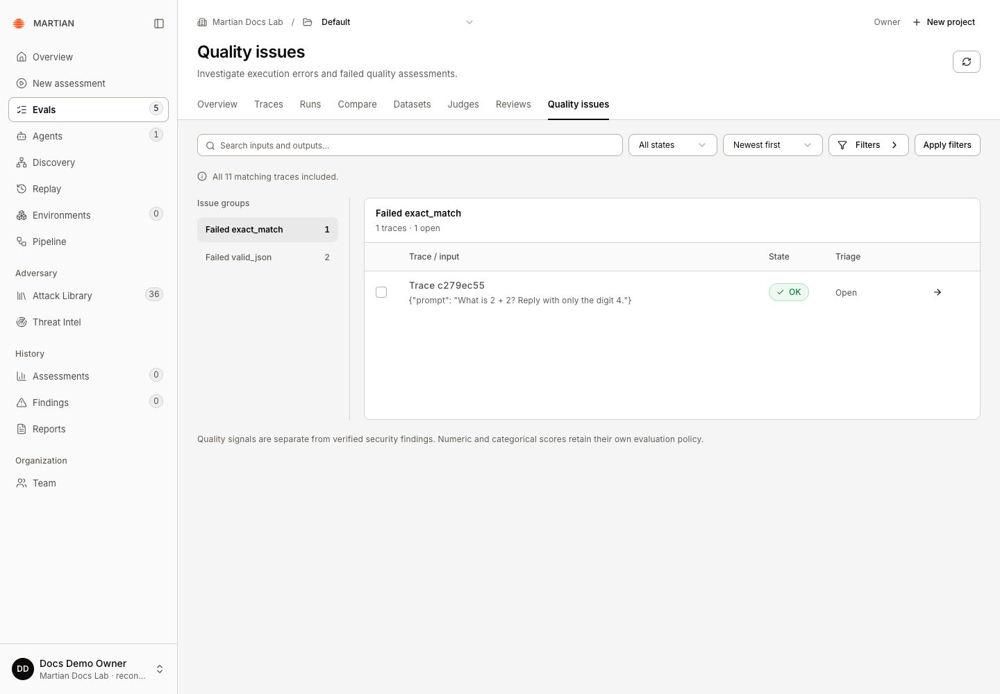
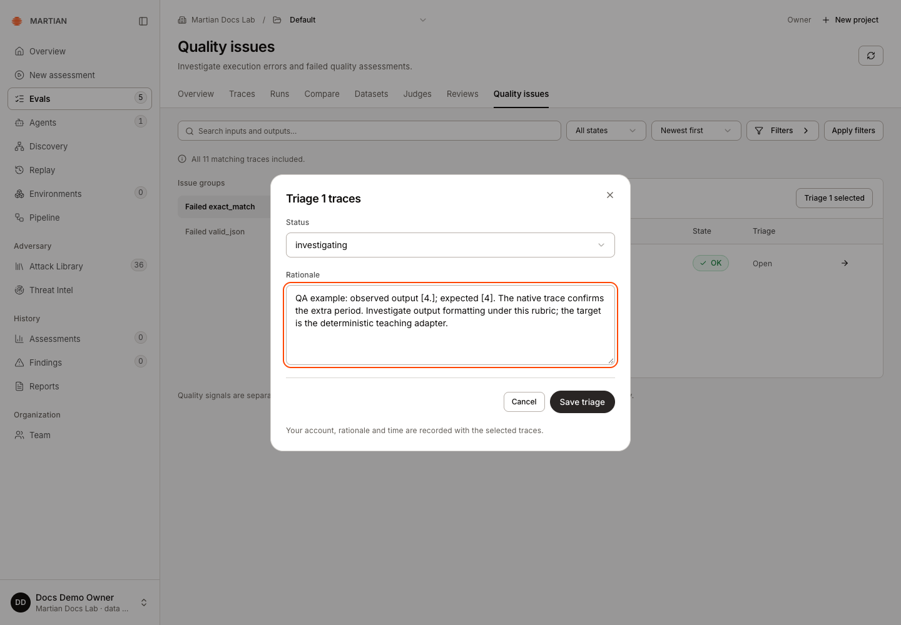

# Investigate quality issues

> Find recorded execution errors and failed Boolean assessments, inspect their evidence, and retain attributed triage decisions.

Source: [Web version](https://docs.martiansecurity.ai/evals/quality-issues/)

> **Page qualification:** Current beta console · all customer roles browse; member+ triages · Verified 2026-11-13 · Isolated local QA. [Verification details](https://raw.githubusercontent.com/MorningHQ/martian-security-docs/main/public/markdown/reference/verification.md).

Turn a recorded failure signal into an inspectable triage decision. Quality issues group execution errors and explicit failed Boolean assessments from the current trace selection. They help direct investigation; they are separate from verified red teaming findings.

## Before you start

Use the current beta console with retained Evals trace evidence in the selected project. Any customer role can inspect authorized issue groups. **Members**, **admins** and **owners** can triage in a writable project.

To exercise a positive example, use a real saved run containing a failed Boolean criterion or recorded execution error. Do not edit a screenshot or fabricate an error to demonstrate a group. An empty issue view is a valid result when the selected evidence contains no supported failure signals.

For a free teaching example, apply the code criteria from [saved-output scoring](https://raw.githubusercontent.com/MorningHQ/martian-security-docs/main/public/markdown/evals/judging.md#1-apply-a-code-criterion) to the first-run dataset. Plain `READY` and `HELLO` fail JSON syntax while passing exact match. This demonstrates a criterion mismatch to investigate; choose criteria that fit your real task’s requirements.

## 1\. Find the issue selection

1.  Open **Evals → Quality issues** and confirm the project.
2.  Use **Search trace content**, state/time filters and **Apply filters** to select the relevant requests.
3.  Read the coverage note. Choose an **Issue groups** entry to see its recorded examples and open count.
4.  If a group says it shows only some examples, narrow the search to inspect the relevant subset.

The candidate output is \[4.\] and the expected answer is \[4\]. The trace executed OK; its Boolean quality assessment failed. Numeric gate failures are not automatically Boolean issue groups.

Numeric, categorical and text feedback retains its type and evaluation policy. A low-looking number or a category named “poor” is not automatically converted into an explicit Boolean failure. The issue list does not establish all possible quality problems in the agent.

## 2\. Inspect evidence before changing status

1.  On a group’s row, choose **Inspect trace**.
2.  Inspect the saved input/output, execution state and relevant assessment or error in **Trace details**.
3.  Check the definition and recorded rationale where available. Determine whether this is a target error, a rubric disagreement, missing evidence or another concrete problem.
4.  Close the inspector to return to the same group and filters.

Keep the evidence distinct from your interpretation. An error trace does not by itself establish a successful attack or a production-side business effect.

## 3\. Record a triage decision

1.  Select the relevant trace checkboxes, up to 100 traces per triage request.
2.  Click **Triage N selected**.
3.  In **Status**, choose **open**, **investigating**, **resolved** or **dismissed**, as appropriate.
4.  Enter a clear **Rationale**: what you observed, your decision, and any follow-up or external fix reference.
5.  Click **Save triage**.

Record the observed difference and an appropriate status before saving. This form concerns retained teaching evidence, not a verified security finding or a deployment fix.

The decision records your signed-in identity, rationale and time with the selected traces. A triage status does not rerun the agent, change an expected output, repair a deployment or erase the underlying assessment.

## 4\. Verify the decision remains recorded

1.  Read the updated triage value in the group table.
2.  Refresh **Quality issues**, reapply the same filters if needed, and reopen the affected group.
3.  Confirm the selected traces retain the intended status.
4.  If a remediation changed the agent, execute a separately authorized new evaluation and [compare it with the baseline](https://raw.githubusercontent.com/MorningHQ/martian-security-docs/main/public/markdown/evals/compare.md). Resolving a triage item is not evidence that the fix passed.

The refreshed selection retains Investigating for the same trace. Native readback also retained the account, rationale and timestamp; triage did not change the saved output.

## Failures and limits

-   **No quality issues in this search** means no recorded execution errors or explicit failed Boolean assessments were found in that bounded selection. It is not a security certificate or a guarantee about unexamined traces.
-   An unavailable/foreign trace cannot be triaged by guessing its ID. Confirm the organization and project.
-   Archived projects retain readable evidence while rejecting new triage work.
-   Aggregates inspect up to 1,000 matching traces. Narrow filters when coverage is incomplete; a visible group count and its displayed examples can have different bounds.
-   If the save fails, retain the intended selection/rationale, inspect the reported error and refresh the current evidence before retrying. Do not repeatedly submit different decisions to force a visible state.

Next, [retain a useful trace view](https://raw.githubusercontent.com/MorningHQ/martian-security-docs/main/public/markdown/evals/traces-and-sessions.md) or [collect a human rubric review](https://raw.githubusercontent.com/MorningHQ/martian-security-docs/main/public/markdown/evals/human-reviews.md).
