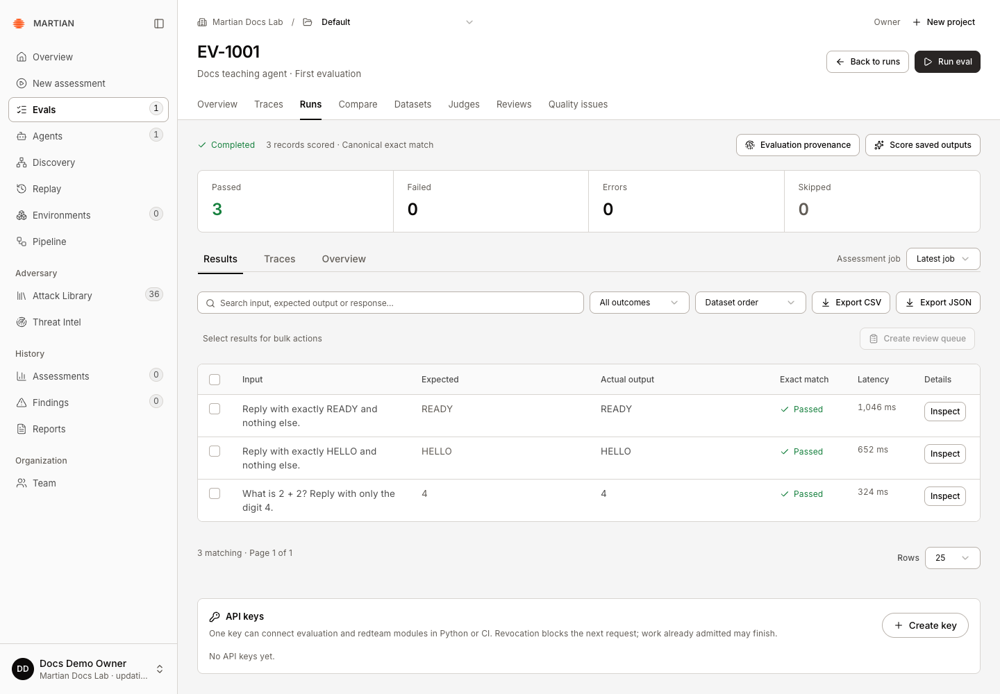
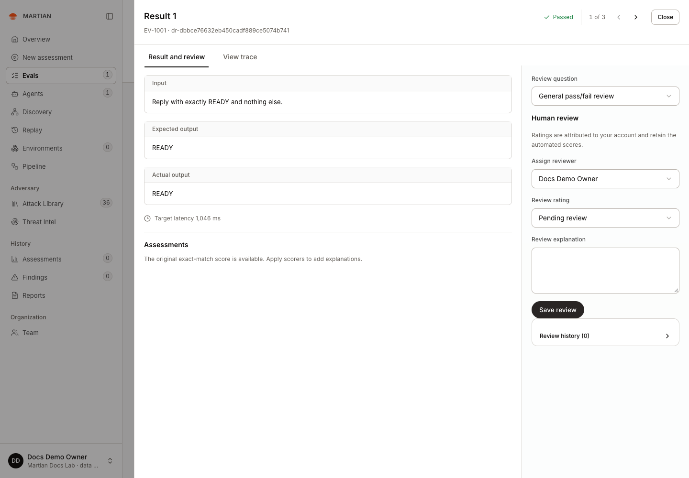
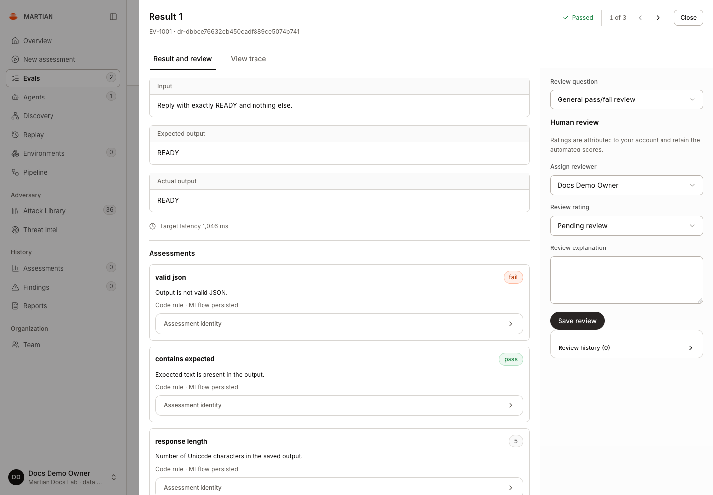
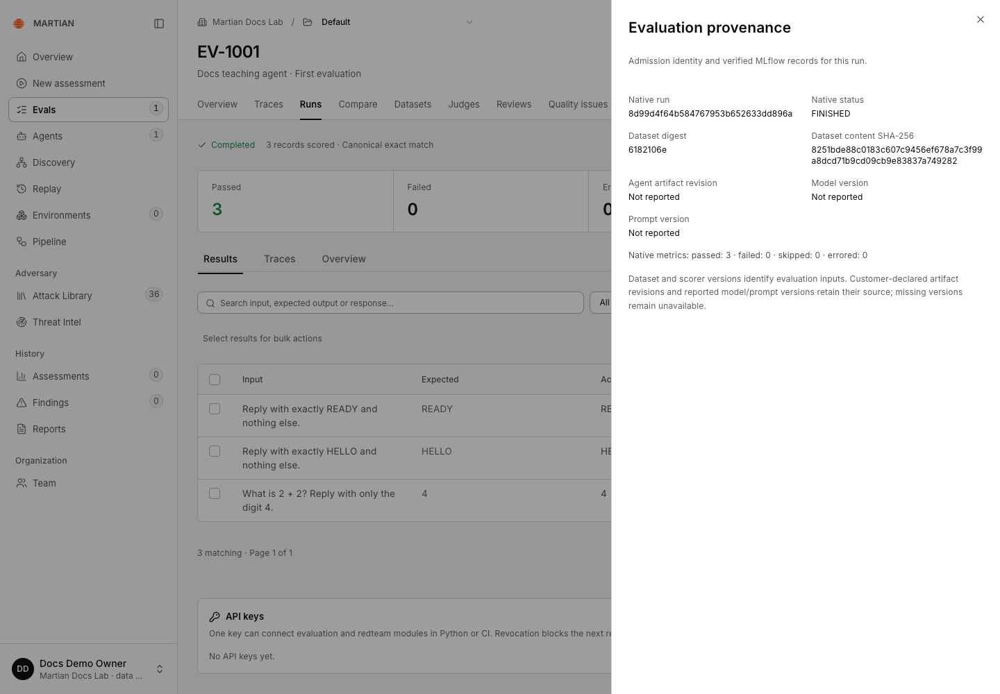

# Understand results and scores

> Inspect record-level outputs, exact-match results, supplementary assessments, exports and evaluation provenance.

Source: [Web version](https://docs.martiansecurity.ai/evals/results-and-scores/)

> **Page qualification:** Current beta console · all customer roles read/export; member+ for supplementary mutations · Verified 2026-11-13 · Isolated local QA. [Verification details](https://raw.githubusercontent.com/MorningHQ/martian-security-docs/main/public/markdown/reference/verification.md).

Read a saved evaluation from its overall execution state down to an individual input, answer and assessment. You will be able to distinguish a failed quality check from a failed request, retain exports, and explain which evidence supports a score.

## Before you start

Any customer role can inspect authorized saved runs in the current beta console. Complete a [first evaluation](https://raw.githubusercontent.com/MorningHQ/martian-security-docs/main/public/markdown/evals/first-run.md) and confirm the correct project. Applying additional scoring or changing human reviews requires **member** access or higher; this guide’s read/export steps do not send new target requests.

## 1\. Open and filter a run

1.  Open **Evals → Runs** and select an `EV-` run code. Use **Search evaluation runs** and paging if necessary.
2.  Read the execution state and record counters. **Completed** means execution finished; it does not mean that every answer passed.
3.  On **Results**, use **Search results**, **Result status** or **Sort results** to find a record.
4.  Adjust **Rows** to page through results. Read **Input**, **Expected**, **Actual output**, **Exact match** and **Latency**.

Completed is the execution state. Inspect each expected and actual answer and its score; this synthetic example has three passes.

| Record result | Interpretation |
| --- | --- |
| Passed | The recorded response satisfied canonical exact match. |
| Failed | A response was recorded but did not match the expected answer. |
| Error | The request or processing path reported an error; read the saved error. |
| Skipped | The selected record was not executed or scored, for example after a cooperative stop or because it was unusable. |
| Pending | A result has not finished yet. |

Exact match compares the response and expected string after trimming outer whitespace and ignoring case. It does not ignore punctuation, remove an explanation, or establish semantic equivalence.

## 2\. Inspect a record

1.  Click **Inspect** on a result.
2.  In **Result and review**, compare the input, expected output and actual output.
3.  Read **Assessments** for any saved code-rule, model or human ratings. Each can retain its rationale, definition identity and persistence state.
4.  Use **View trace** for available execution evidence. **Previous result** and **Next result** let you inspect adjacent filtered results.

Inspect opens one retained record. Human review and supplementary assessments are separate from its original exact-match result.

Save or resolve an edited human review before navigating away when the drawer reports **Review changes pending**. Read [human reviews](https://raw.githubusercontent.com/MorningHQ/martian-security-docs/main/public/markdown/evals/human-reviews.md) before assigning ratings.

## 3\. Interpret supplementary scores

For project-wide trace volume, latency, recorded usage and typed quality aggregates, use the separate [Evals dashboard guide](https://raw.githubusercontent.com/MorningHQ/martian-security-docs/main/public/markdown/evals/overview.md). The run-level Overview below describes this evaluation’s saved assessment jobs.

Open the run’s **Overview** and choose the relevant **Assessment job**. Supplementary criteria do not replace the original exact-match result:

-   **Contains expected text** checks a case-insensitive expected substring.
-   **Valid JSON** checks that the saved output parses as supported JSON; it does not check your application’s domain schema.
-   **Response length (characters)** reports Unicode character count.
-   Model judges and human ratings record opinions or rubric results with their own source and definition.

Boolean criteria can show pass rates and coverage. Numeric criteria retain numeric summaries; categorical and text values are not converted into a Boolean pass rate. A missing assessment is not a passing value. See [saved-output judging](https://raw.githubusercontent.com/MorningHQ/martian-security-docs/main/public/markdown/evals/judging.md) and [suites and quality gates](https://raw.githubusercontent.com/MorningHQ/martian-security-docs/main/public/markdown/evals/suites-and-monitoring.md).

Supplementary code assessments do not replace canonical exact match. A JSON-syntax failure and a passing exact-match answer can both be correct under their different definitions.

## 4\. Inspect provenance and export

1.  Open **Evaluation provenance** and inspect the recorded run, dataset and available target/artifact identity.
2.  Return to **Results**, apply the filters you want to retain, and select **Export CSV** or **Export JSON**.
3.  Check the downloaded records against the visible selection. The result export follows the displayed filters; a small filtered export is not a complete-run export.
4.  Refresh and reopen the same run to confirm its results and assessment job remain available.

Native FINISHED and three passed metrics were read back. The dataset hash matches publication; absent agent, model and prompt revisions remain Not reported.

Dataset versions and declared artifact revisions describe what was recorded at admission. Unreported model or prompt versions remain unavailable. An agent name is not proof of a specific deployed model or prompt revision.

## Failures and limits

-   **MLflow telemetry needs administrator review** means native evidence may be incomplete even when local results exist. Retain the run code and ask your administrator to investigate; do not rerun the target merely to repair telemetry.
-   **Sync saved feedback** retries delivery of an existing assessment. It does not justify inventing a missing value or treating an uncertain write as persisted.
-   Latency and token/cost data describe recorded values. Missing usage is not zero usage and is not an independently verified bill.
-   Quality scores, human opinions and model opinions are separate from verified adversarial findings.

Next, [compare runs](https://raw.githubusercontent.com/MorningHQ/martian-security-docs/main/public/markdown/evals/compare.md) or [inspect native traces](https://raw.githubusercontent.com/MorningHQ/martian-security-docs/main/public/markdown/evals/traces-and-sessions.md).
