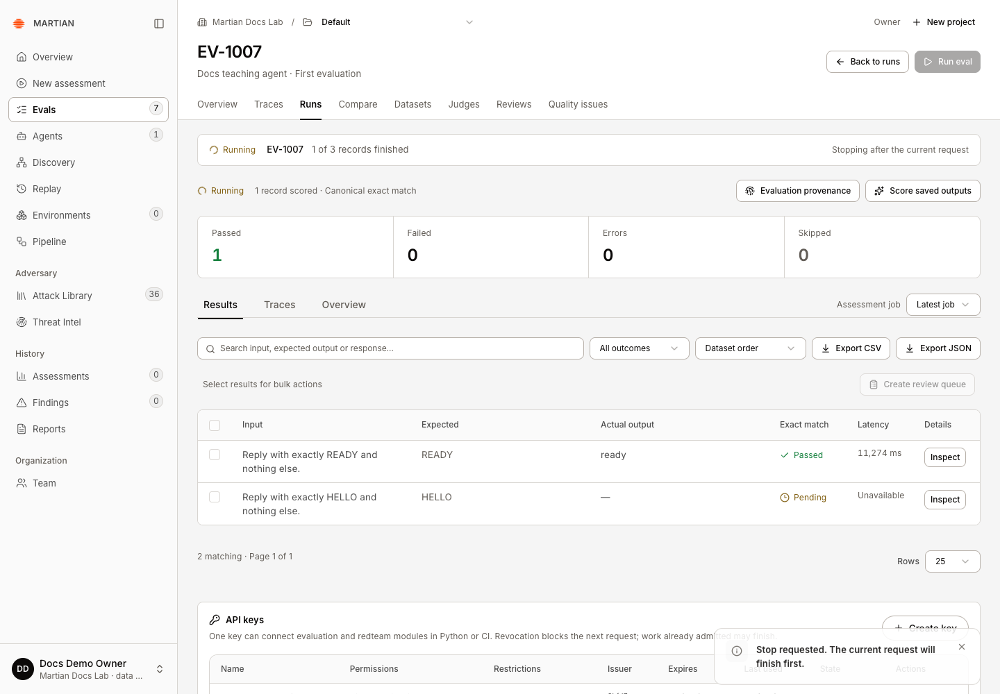
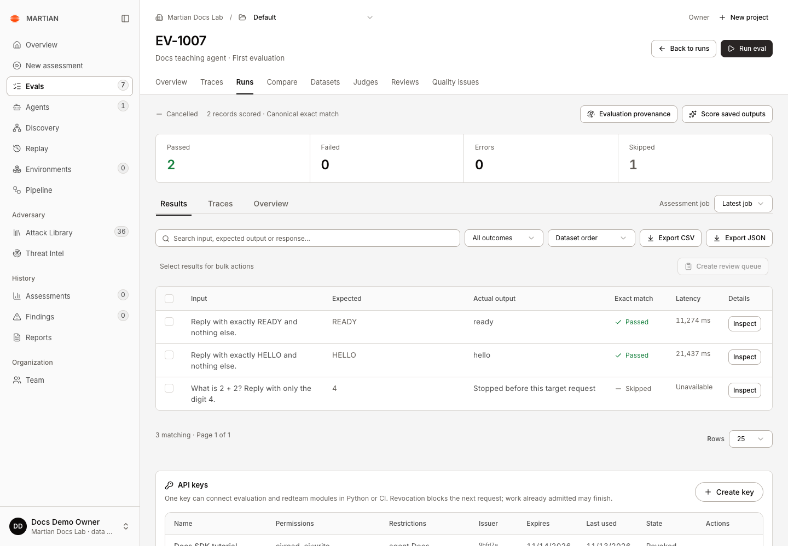
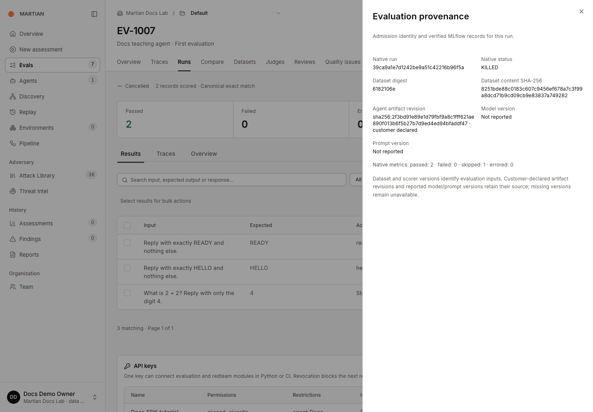
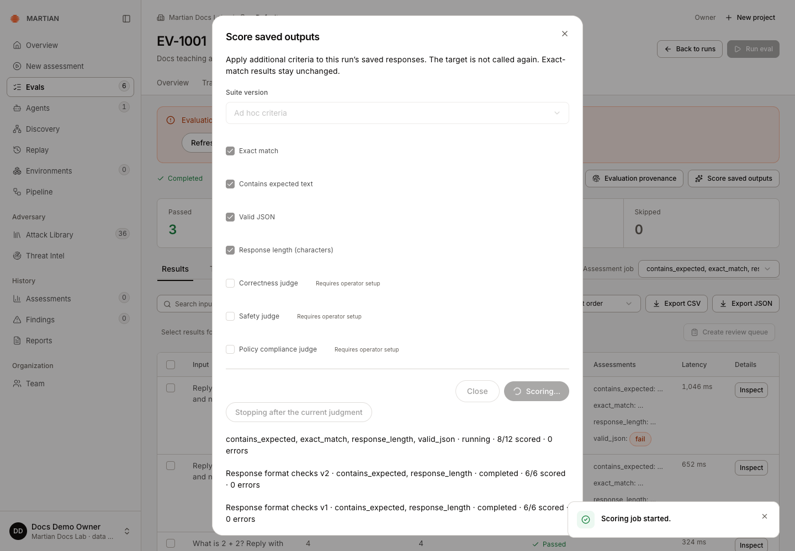
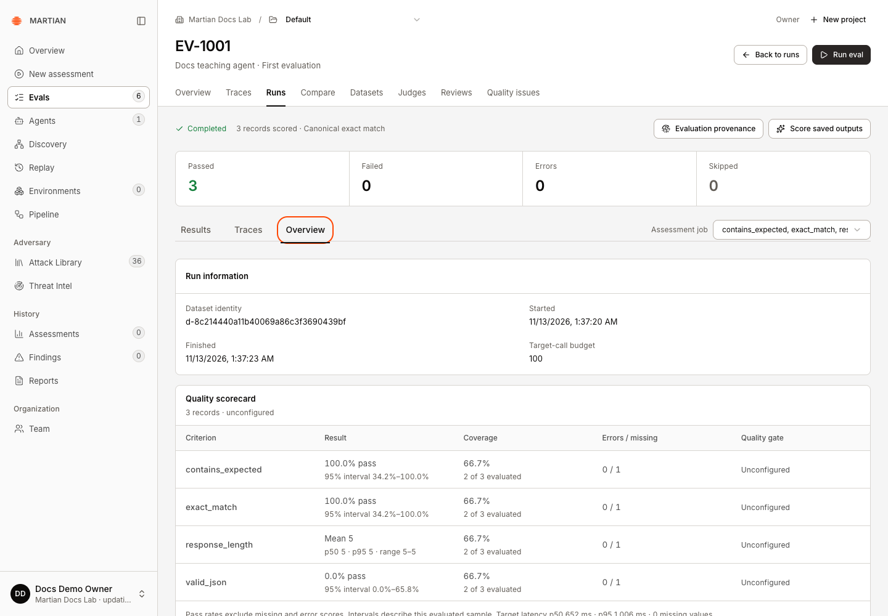

# Stop runs and recover uncertain work

> Stop target evaluations or saved-output scoring cooperatively, preserve retained evidence, and resolve uncertain submissions safely.

Source: [Web version](https://docs.martiansecurity.ai/evals/stopping-and-recovery/)

> **Page qualification:** Current beta console · member+ stops; all customer roles inspect retained work · Verified 2026-11-13 · Isolated local QA (HTTP + code criteria). [Verification details](https://raw.githubusercontent.com/MorningHQ/martian-security-docs/main/public/markdown/reference/verification.md).

Request a bounded stop without discarding results that have already arrived, and distinguish an unresolved acknowledgement from a new launch. This guide covers customer controls in the current beta console; it does not require internal worker, database or MLflow administration.

## Before you start

**Members**, **admins** and **owners** can request stops for authorized work. A **viewer** can inspect status and retained evidence. A target run must still be queued or running; scoring must still have an active job.

Use a deliberately bounded, authorized example when learning the controls. A stop is cooperative: a target request or model judgment already admitted can finish and may incur its normal charge. Stop is not a way to revoke an already sent request or undo external side effects.

For optional practice with the [HTTP teaching adapter](https://raw.githubusercontent.com/MorningHQ/martian-security-docs/main/public/markdown/agents/http-adapter.md), its [complete example README](https://raw.githubusercontent.com/MorningHQ/martian-security-docs/main/public/examples/http-agent/README.md) includes `slow_agent:answer`. That genuine callback waits ten seconds. Confirm deadline headroom with your administrator before using it; the recorded local QA success used a 90-second request budget. Keep the original three-record dataset and stop after at least one record finishes.

## 1\. Stop a target evaluation

1.  Open **Evals → Runs** in the active run’s project.
2.  Locate its `EV-` progress row and finished-record count.
3.  Click **Stop after current request** once.
4.  Observe **Stopping after the current request**. Wait for the in-flight request and finalization to finish.

EV-1007 shows Stopping after the current request after the first record passed. The next response is still pending; acknowledgement alone is not terminal completion.

A queued run may stop before sending any request. An active run retains the current response and skips the selected records that have not been started. Other projects share the same organization-wide target-run admission limit.

## 2\. Verify the cancelled result

1.  Open the run detail and wait for **Cancelled**.
2.  Inspect retained responses and **Skipped** rows. Do not count skipped records as passing checks.
3.  Open **Evaluation provenance** and inspect the native run state when available; a verified cancelled native run is recorded as **KILLED**. A queued stop can finish before a native run exists.
4.  Refresh and reopen the same run. Confirm its terminal state and retained rows remain available.

After refresh, the same cancelled run retains READY/HELLO responses, two passes, zero errors and one unstarted skipped record. Two requests reached the actual teaching target.

In the recorded success, the stop was requested after the first record finished. The second in-flight response also arrived: **2 Passed, 0 Errors, 1 Skipped** remained after refresh. Native provenance showed **KILLED** with the same counts. Two actual requests reached the teaching target.

Native provenance independently reads KILLED for this retained cancelled run, with two passed, zero failed, one skipped and zero errored metrics. The callback revision is explicitly customer-declared.

A cancellation acknowledgement is intent to stop, not proof that all physical work has ended. Wait for the terminal run state and relevant evidence before launching another evaluation. If the run has already finished, the UI/API can reject a late stop and keep its recorded result.

A cancelled run can also retain target errors. An earlier local attempt had two errors and one skipped record; its native state was still KILLED. Read the retained rows and any telemetry warning before interpreting cancellation as a successful target interaction.

## 3\. Stop saved-output scoring

1.  Open the completed target run and its **Score saved outputs** dialog. After **Apply scorers** admits a job, the dialog closes; reopen **Score saved outputs** while that job is still active.
2.  While a scoring job is active, click **Stop scoring after current judgment**.
3.  Observe **Stopping after the current judgment** and wait for the job to finish stopping.
4.  Inspect the selected **Assessment job** and the assessments already retained. Refresh and confirm the same job state and saved feedback.

The stop was acknowledged while eight of twelve code assessments had been produced. The configuration stays disabled while stopping. A separate local setup warning was visible behind the dialog; the retained source run remained Completed.

This stops supplementary scoring, not the target run that already completed. The in-flight judgment can finish; retained assessments are preserved, and unscored results remain missing. Partial coverage must not be interpreted as a passing full-run gate.

In the recorded code-only example, four criteria were selected for three saved responses. The stop was accepted at **8/12 scored**. The same cancelled job retained eight native assessments after refresh, with **2 of 3 evaluated** for each criterion and one missing value. The original target run still had three canonical passes. Here, “scored” counts assessments, including failing Boolean values; it does not count passing records.

After refresh and explicit selection of the cancelled job, each of four criteria shows two of three records evaluated and one missing value. All eight retained assessments had native IDs; the original target run still had three canonical passes.

## 4\. Resolve an uncertain acknowledgement

A network failure can occur after the service accepted a request but before the browser received its response. Use the action tied to the saved request:

| Screen | Action |
| --- | --- |
| Target-run launch | **Retry saved launch** |
| Saved-output scoring | **Retry saved scoring request** |
| Human answer | **Retry saved review** |
| Suite/queue mutation | **Retry saved request**, when offered |
| Project creation | **Retry project setup**, when offered |

Keep the original configuration while reconciling. These actions reuse the saved request identity to inspect/admit the same operation; they are not a request to run the target or paid model repeatedly until it passes. A request identity cannot be reused with different content.

## 5\. Handle setup, publication or telemetry failures

-   **Dataset updates are in progress**: new runs are paused while publication completes. Existing admitted runs may finish. An owner/admin can inspect **Datasets → Publish activity** for a stalled operation; use the [dataset recovery guidance](https://raw.githubusercontent.com/MorningHQ/martian-security-docs/main/public/markdown/evals/datasets.md#failures-and-recovery).
-   **Refresh setup**: refreshes the readiness read after the underlying problem is resolved. It cannot authorize an unapproved connection or create missing model access.
-   Saved results with telemetry errors need administrator review. Retain the run/job code and error, rather than deleting evidence or rerunning the target to repair export.
-   A rotated, changed, expired or revoked agent connection can stop later target calls. Revalidate/approve through [Agents](https://raw.githubusercontent.com/MorningHQ/martian-security-docs/main/public/markdown/agents/connections.md) before admitting new work.

If uncertainty remains after refreshing and reconciling the saved request, give your administrator the run code, job identity, time and displayed error. Avoid including tokens, passwords or unneeded response content in support messages.

Next, [inspect retained results](https://raw.githubusercontent.com/MorningHQ/martian-security-docs/main/public/markdown/evals/results-and-scores.md) or [start another bounded evaluation](https://raw.githubusercontent.com/MorningHQ/martian-security-docs/main/public/markdown/evals/first-run.md) once the organization is ready for new work.
