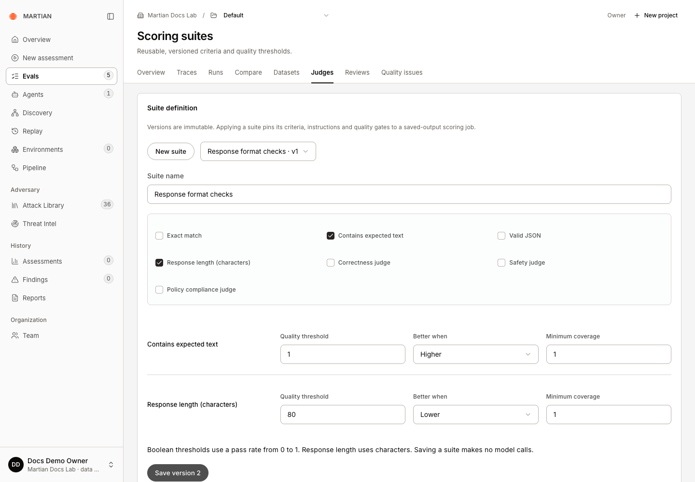
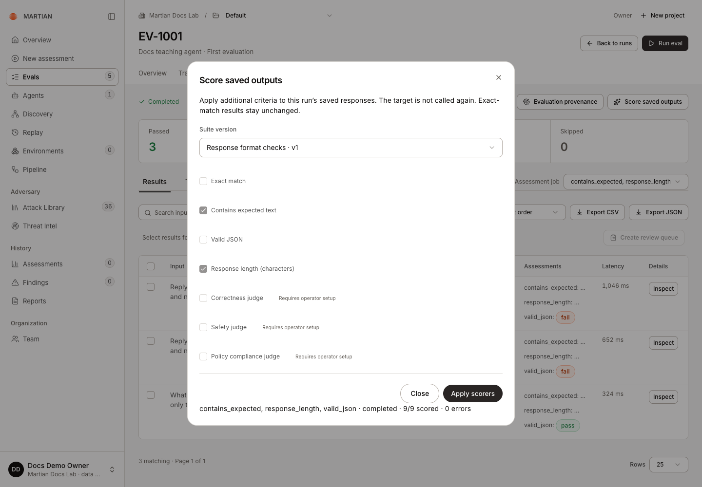
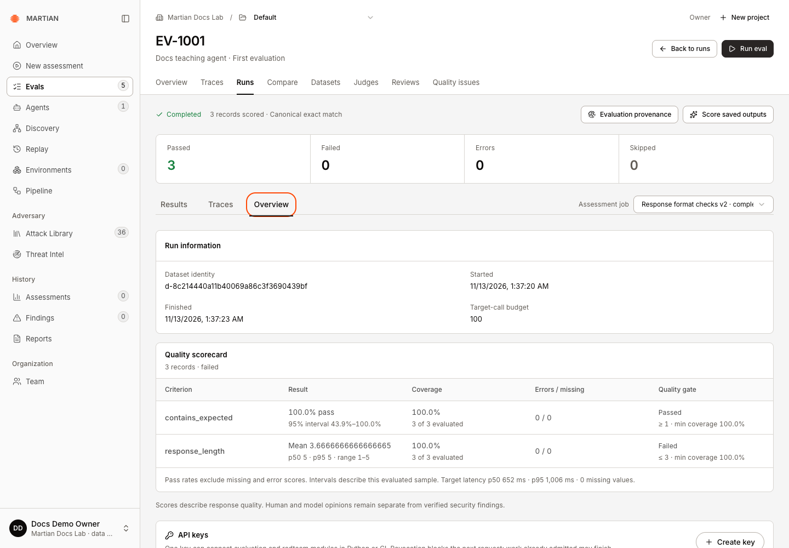
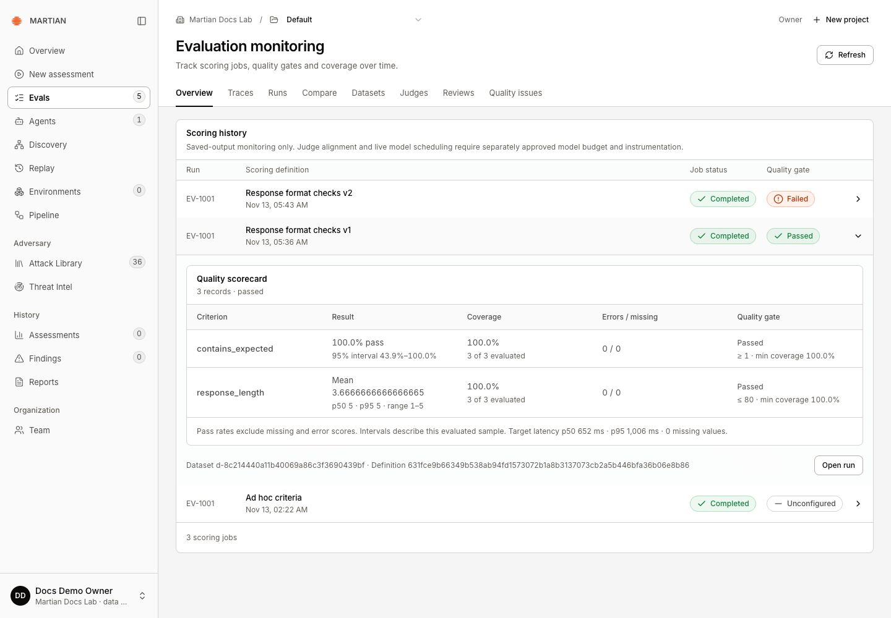

# Use scoring suites and monitoring

> Save immutable scoring criteria and thresholds, apply an exact suite version, and inspect retained quality-gate history.

Source: [Web version](https://docs.martiansecurity.ai/evals/suites-and-monitoring/)

> **Page qualification:** Current beta console · member+ versions/applies suites; all customer roles read monitoring · Verified 2026-11-13 · Isolated local QA (code criteria). [Verification details](https://raw.githubusercontent.com/MorningHQ/martian-security-docs/main/public/markdown/reference/verification.md).

Save criteria and quality thresholds as a reusable suite, apply a particular version to completed outputs, and monitor its retained jobs and gate outcomes. This keeps a quality policy consistent across runs instead of rebuilding it differently each time.

## Before you start

Use your organization in the current beta console. **Members**, **admins** and **owners** can create/version suites and apply them to completed runs. Any customer role can inspect authorized monitoring history. Have a completed evaluation in a writable project and understand the [meaning of its scores](https://raw.githubusercontent.com/MorningHQ/martian-security-docs/main/public/markdown/evals/results-and-scores.md).

Saving a suite makes no model calls. Applying code criteria uses saved outputs. Applying model criteria additionally needs enabled model judging and explicit cost acknowledgement. Custom registered judges are applied separately from these built-in-criterion suite definitions.

## 1\. Create a small code-scoring suite

1.  Open **Evals → Judges**, then choose **Scoring suites**.
2.  In **Suite definition**, choose **New suite** if another version is selected.
3.  Enter **Suite name**, for example **Response format checks**.
4.  Select **Contains expected text** and **Response length (characters)**.
5.  For `contains_expected`, set **Quality threshold** to `1`, **Better when** to **Higher**, and **Minimum coverage** to `1`.
6.  For `response_length`, choose a ceiling for the **mean character count**, set **Better when** to **Lower**, and keep **Minimum coverage** at `1`. For the short answers in the first-run tutorial, an example mean ceiling is `80`.
7.  Click **Create suite** and confirm that version 1 is selected.

Response format checks v1 pins containment at 1 and mean response length at most 80 characters, with full coverage. Saving this definition makes no model calls.

A Boolean threshold is a pass rate from `0` to `1`. A response-length threshold compares the **mean** across evaluated records; it is not a maximum allowed for every response. Inspect the range and individual results when outliers matter. Minimum coverage is also `0` to `1`; full coverage prevents missing/error assessments from being treated as satisfactory evidence. A blank threshold means that criterion has no configured gate; it is not an implicit passing gate.

## 2\. Apply an exact suite version

1.  Open a completed run and choose **Score saved outputs**.
2.  In **Suite version**, select **Response format checks · v1**.
3.  Confirm the pinned criteria and any policy instructions. Their controls are locked to the suite definition.
4.  If the chosen suite includes model criteria, read and select the provider-charge acknowledgement. The example code-only suite does not require a model call.
5.  Click **Apply scorers** and wait for completion.
6.  Select the resulting **Assessment job** and open the run’s **Overview** to inspect its scorecard, thresholds, coverage and gate results.

Select the exact suite version before applying it. The pinned code criteria are locked; this job scores saved responses without calling the teaching target again.

The completed v1 job has full coverage and no missing or error scores. Its response-length gate compares a mean of 3.67 with the ceiling of 80; the recorded range is 1–5.

A gate can be **Passed**, **Failed**, **Insufficient coverage** or **Unconfigured**. Job completion and gate success are different: a finished job may show a failed or unconfigured gate. Review the actual values and coverage before acting on the summary.

## 3\. Create a new version without changing history

1.  Return to **Scoring suites** and choose the prior version in **Edit suite version**.
2.  Change the relevant criteria, instructions or thresholds. For this teaching example, lower `response_length` from `80` to `3`, retaining its **Lower** direction and full coverage.
3.  Click **Save version 2**.
4.  Repeat [Apply an exact suite version](https://raw.githubusercontent.com/MorningHQ/martian-security-docs/main/public/markdown/evals/suites-and-monitoring.md#2-apply-an-exact-suite-version), selecting **Response format checks · v2** on the **same completed run**. Wait for the new scoring job to finish and inspect its **Overview**.

In the teaching example, version 2 lowers the mean response-length ceiling from `80` to `3`. The same three saved answers have mean length about `3.67`, so this newer gate fails while their canonical exact-match results remain passed. The earlier version 1 job still retains its passing `80`\-character policy.

The newer ceiling of 3 fails against the same mean of 3.67. Job completion, quality-gate success and canonical exact-match results are separate outcomes; v1 remains unchanged.

5.  In **Assessment job**, select the earlier version 1 job and confirm that it still records version 1 and its original definition.

Use the same historical suite version when you want a [paired comparison](https://raw.githubusercontent.com/MorningHQ/martian-security-docs/main/public/markdown/evals/compare.md) under an unchanged policy. A different version may be intentionally useful, but it is a different scoring definition.

## 4\. Inspect monitoring history

Project [Overview](https://raw.githubusercontent.com/MorningHQ/martian-security-docs/main/public/markdown/evals/overview.md) summarizes native trace activity and feedback. Monitoring on this page summarizes saved scoring jobs and gates; the two views answer different questions.

1.  Open **Evals → Overview** and choose **Monitoring**.
2.  Read **Scoring history**, including the run, scoring definition, job status and quality gate.
3.  Select a history entry to expand its scorecard, then choose **Open run**.
4.  In the opened run’s **Assessment job**, select the matching suite version and time. **Open run** initially shows that run’s latest job, which may use a newer policy than the history entry you opened.
5.  Refresh, reselect that historical job if needed, and confirm its suite version and gate result remain available.

Select a history entry to inspect its retained definition and gate. Open run starts on the latest job, so reselect the historical Assessment job when following an older entry.

Monitoring here is saved-output scoring history. It does not automatically schedule production target calls, continuously test a deployment, or establish model drift. Those claims require separate instrumentation and an explicitly supported execution workflow.

## Failures and recovery

-   A stale suite-version edit requires reloading the latest saved definition before another version is admitted.
-   **Retry saved request** checks an unresolved suite save. Do not create a different suite merely to bypass an uncertain response.
-   One scoring job per organization can be active at a time. Wait for it to finish or use the [cooperative scoring stop](https://raw.githubusercontent.com/MorningHQ/martian-security-docs/main/public/markdown/evals/stopping-and-recovery.md).
-   A policy criterion requires its policy instructions. Missing assessments, provider errors and incomplete coverage need review; they are not Boolean passes.

Next, [compare matching suite jobs](https://raw.githubusercontent.com/MorningHQ/martian-security-docs/main/public/markdown/evals/compare.md) or [triage recorded quality issues](https://raw.githubusercontent.com/MorningHQ/martian-security-docs/main/public/markdown/evals/quality-issues.md).
