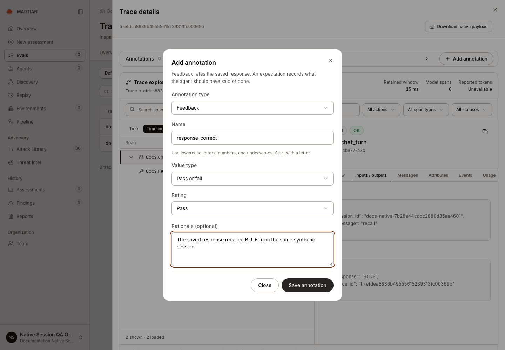
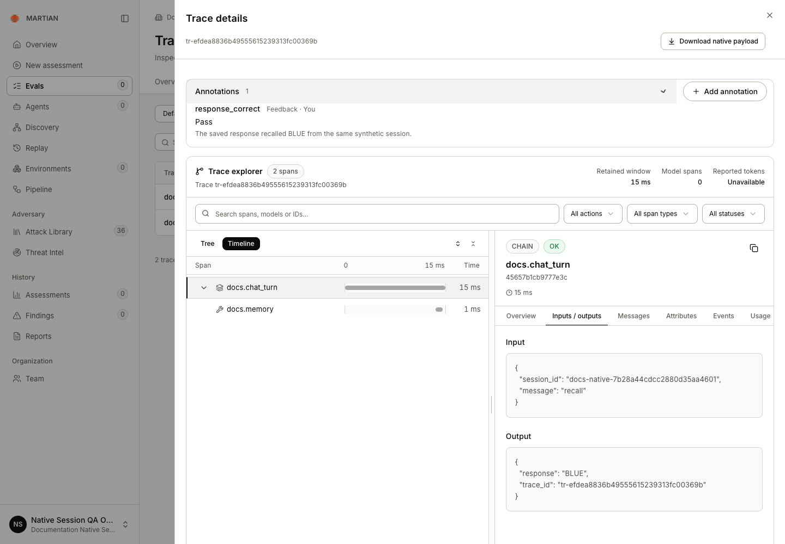

# Annotate a native trace

> Add typed human feedback or an expectation to a retained trace and recover an uncertain save without creating a duplicate.

Source: [Web version](https://docs.martiansecurity.ai/evals/trace-annotations/)

> **Page qualification:** Current beta console · member/admin/owner writes; authorized roles read · Verified 2026-11-13 · Isolated local QA; native traces. [Verification details](https://raw.githubusercontent.com/MorningHQ/martian-security-docs/main/public/markdown/reference/verification.md).

Attach a human opinion or expected behavior to a native trace, including a conversation trace that has no dataset evaluation run. This is separate from [assigned human-review queues](https://raw.githubusercontent.com/MorningHQ/martian-security-docs/main/public/markdown/evals/human-reviews.md). Saving an annotation does not execute a target or model.

## Before you start

Any authorized customer role can read annotations. A **member/admin/owner** can add one in a ready, writable project. Archived projects are read-only. Start from an existing trace you are authorized to inspect.

The screenshots annotate the retained **recall → BLUE** trace from the [native conversation walkthrough](https://raw.githubusercontent.com/MorningHQ/martian-security-docs/main/public/markdown/evals/traces-and-sessions.md#3-group-recorded-conversations). Adding feedback to that trace does not repeat either conversation turn.

## 1\. Open the annotation form

1.  Open **Evals → Traces**, confirm **Project**, and open the intended trace’s **Trace details**.
2.  Choose **Add annotation** in **Annotations**.
3.  Select **Annotation type**: **Feedback** or **Expectation**.
4.  Enter **Name**: start with a lowercase letter, then use lowercase letters, digits or underscores, up to 60 characters. `exact_match` is reserved.

This real form rates the saved recall response. Save appends feedback to that trace without calling the target again.

## 2\. Enter the value and save once

| Type | Fields | Use it for |
| --- | --- | --- |
| Feedback → Pass or fail | Rating: Pass / Fail; optional rationale | A Boolean human judgment |
| Feedback → Number | Numeric rating; optional rationale | A numeric human judgment |
| Feedback → Text | Feedback text; optional rationale | A textual observation |
| Expectation | Expected response or behavior | Text describing what should have happened |

1.  Choose **Value type** for Feedback and enter its **Rating** or **Feedback text**. **Rationale (optional)** supports up to 2,000 characters.
2.  For Expectation, enter **Expected response or behavior**, up to 4,000 characters. It has no separate rationale field.
3.  Review the trace, name, type and value, then select **Save annotation** once. **Close** leaves the form without submitting it.
4.  Read the saved annotation’s type, value and author. Your own annotation shows **You**. Refresh and reopen the same trace to confirm it remains in **Annotations**.

After page refresh and a supported Refresh traces recovery, the same Boolean annotation remains beside the original recall input and BLUE output.

## 3\. Recover an uncertain save

An uncertain response can leave the form locked to its original submission. Use **Retry annotation** for that same submission; it retains the request identity and reads back the corresponding native assessment.

If the form closed successfully but a later trace read fails, use **Refresh traces**, reopen the trace and inspect **Annotations**. A read failure does not establish that the save failed.

If that form/browser intent is no longer available, reopen the trace and inspect its existing annotations before beginning a fresh submission. A new submission creates another annotation rather than editing the previous one. The current UI does not offer annotation edit/delete; do not use repeated fresh saves as a retry strategy.

## Understand what changed

Feedback and Expectation are retained human assessments. They do not rewrite span inputs/outputs, published dataset answers, canonical evaluation results, a scoring job or a review queue. Feedback can contribute to the native dashboard’s typed quality summary; Boolean false feedback can contribute to Quality issues. Expectation text is not projected as a feedback score.

A human annotation is an opinion or expectation, not a model judgment or independently verified security finding. Keep sensitive values within the trace’s authorized audience.

Continue with [Evals dashboard summaries](https://raw.githubusercontent.com/MorningHQ/martian-security-docs/main/public/markdown/evals/overview.md) or [quality issues](https://raw.githubusercontent.com/MorningHQ/martian-security-docs/main/public/markdown/evals/quality-issues.md).
