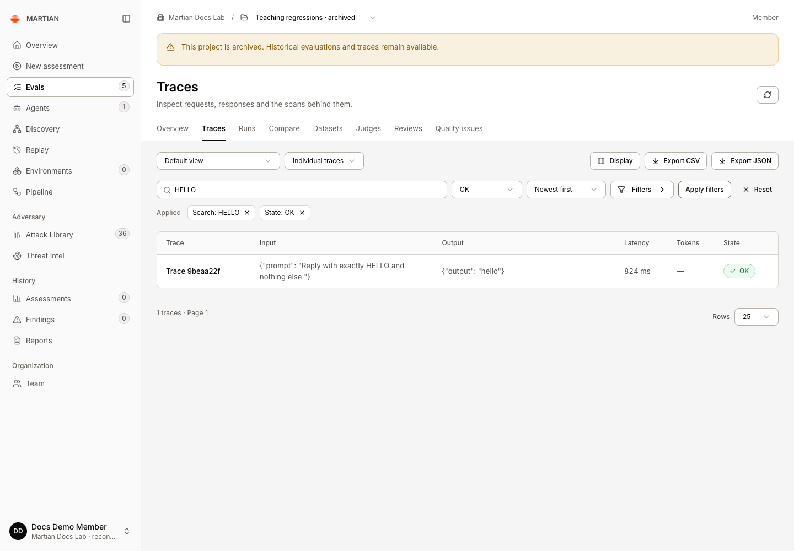
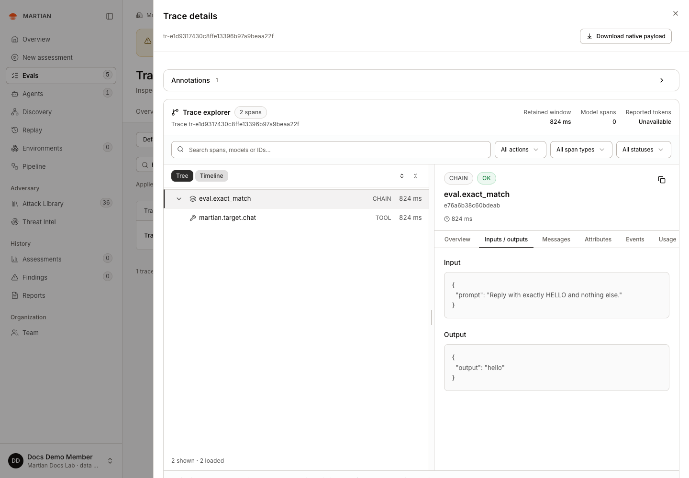
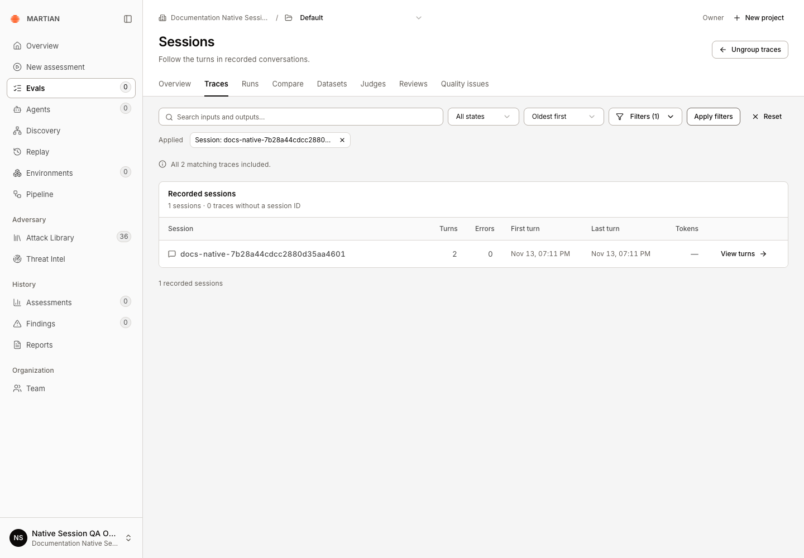
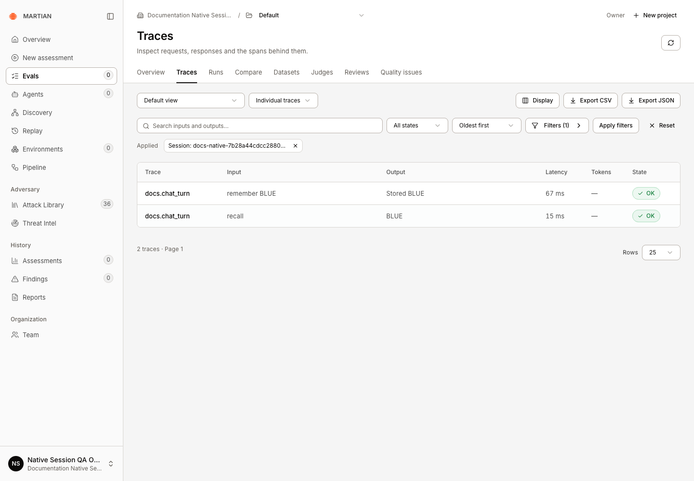
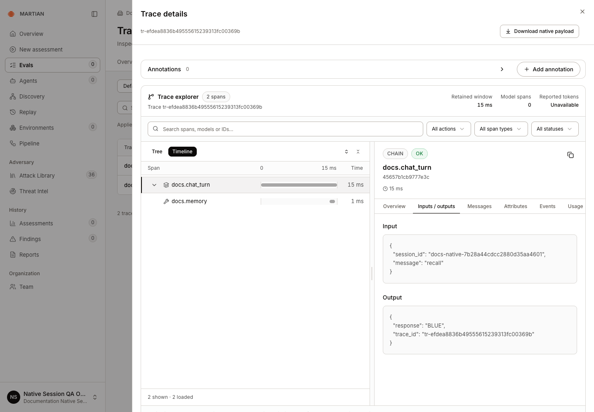
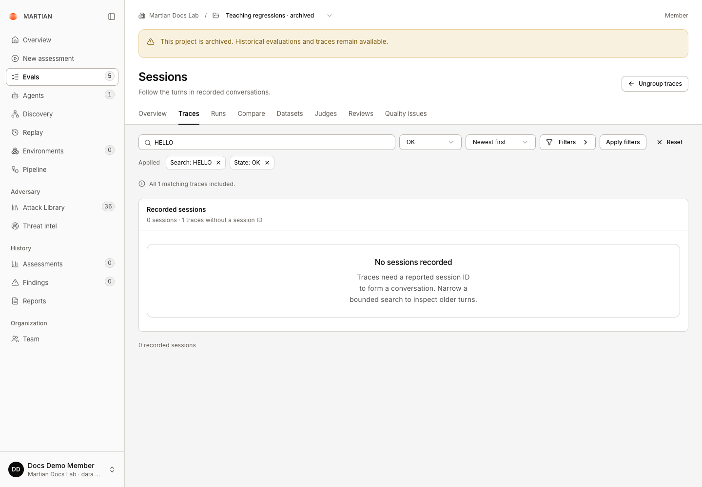
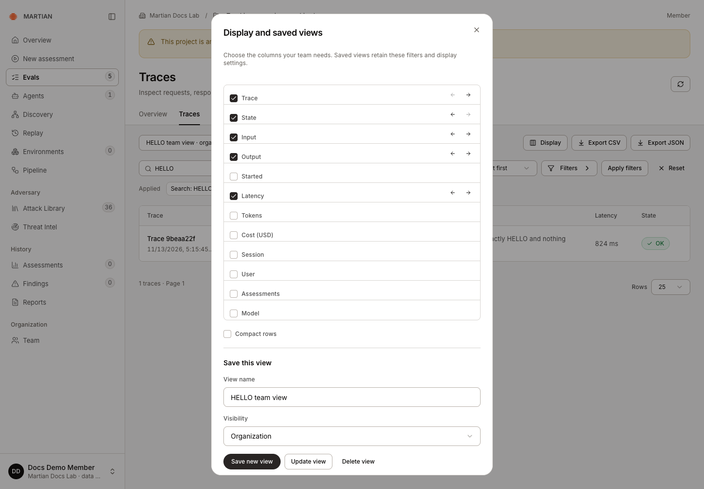

# Inspect traces and sessions

> Search native trace evidence, inspect spans, group recorded sessions, save views and export bounded results.

Source: [Web version](https://docs.martiansecurity.ai/evals/traces-and-sessions/)

> **Page qualification:** Current beta console · all customer roles read/export; member+ saves views · Verified 2026-11-13 · Local QA; trace/view workflows and separately provisioned native sessions. [Verification details](https://raw.githubusercontent.com/MorningHQ/martian-security-docs/main/public/markdown/reference/verification.md).

Use the trace explorer to follow recorded requests and inspect the spans, inputs, outputs and assessments behind an evaluation. Group by a reported session ID when you need a conversation view. These reads do not execute a target again.

## Before you start

Any customer role can inspect authorized native traces in the current beta console. Your organization must have ready Evals setup and retained trace evidence in the selected project. **Members** or higher can save views; viewers can use organization-shared views. You do not need a separate MLflow login or MLflow credentials.

Complete a [first evaluation](https://raw.githubusercontent.com/MorningHQ/martian-security-docs/main/public/markdown/evals/first-run.md) to create fresh evidence. Not every request reports a session, user, token count, cost or model identity. Missing fields stay unavailable.

## 1\. Find the trace selection

1.  Open **Evals → Traces** and confirm the project.
2.  Enter distinctive input/output text in **Search trace content**.
3.  Choose **Trace state** or **Trace order** if needed.
4.  Open **More filters** for **Session ID**, **User ID**, **Minimum latency (ms)**, **Time window**, **Boolean assessment** and **Assessment value**.
5.  Click **Apply filters** and read the applied-filter summary and coverage note. Use **Reset** to clear filters deliberately.

The applied HELLO and OK filters return one recorded request. Archiving preserves this evidence; reading it does not rerun the target.

Start with a narrow, known request or recent time window. An empty selection is not proof that the agent never ran; confirm the organization, project, filters and trace retention.

## 2\. Inspect native execution evidence

1.  Open a trace from the table to display **Trace details**.
2.  Begin with **Inputs / outputs** and compare the recorded values with the saved evaluation result.
3.  Inspect available **Overview**, **Messages**, **Attributes**, **Events** and **Usage** tabs. Use the span/tree or timeline controls shown by the inspector for the recorded trace structure.
4.  Expand **Trace assessments and metadata** to inspect retained feedback and identifiers.
5.  Choose **Download native payload** when you need the retained native evidence for an authorized review.

The capture below shows **Trace details** opened from the filtered trace table, with two native spans and the recorded input/output. For a trace attached to an evaluation result, you can also use the run’s **Results → Inspect → View trace** path.

The trace-table inspector retains the real input/output and two spans. There are 0 model spans and reported tokens are unavailable; missing usage is not zero usage.

A missing usage field is not zero usage. Reported model names, costs and span events describe what was retained; they do not independently verify billing, deployed code or a business-side effect. Treat trace downloads as potentially sensitive and share them according to your organization’s policy.

## 3\. Group recorded conversations

The example below uses a separate synthetic HTTP application with native MLflow 3.16.1 instrumentation and an operator-provisioned application writer. Two actual requests stored `BLUE`, then recalled it. Each request produced a separate completed trace with the same reported session ID. This verifies the conversation view; it does not qualify SDK 0.1.2 ingestion or model behavior. Viewing these records in Martian needs only your normal customer sign-in.

1.  Return to Traces. To inspect a known conversation, open **Filters** (**More filters** to assistive tools), enter its **Session ID** and click **Apply filters**. Set **Group traces by** to **Group by session**.
2.  Inspect **Recorded sessions**, turns, errors and first/last recorded times. This bounded example contains one session, **2** turns, **0** errors and no ungrouped traces.

Two real HTTP requests share a reported native session ID. Recorded sessions includes both completed traces; tokens stay unavailable. This uses separately provisioned native instrumentation.

3.  Choose **View turns** to inspect one session while retaining its applied filters.

View turns opens the two persisted requests in the same session. The actual HTTP application stored and recalled BLUE; these reads do not run the application again.

4.  Open each trace to compare the real request and response. Refresh and confirm that both turns remain. **Ungroup traces** returns from Sessions to the individual trace table.

The recall request retained its real memory operation and BLUE output. There are no model spans, and missing token/cost values remain unavailable.

Sessions require a reported session ID. A set of independent dataset requests is not automatically a multi-turn conversation. If you see **No sessions recorded**, inspect individual traces and confirm that the target/instrumentation reports the session identifiers you expect.

An SDK **CI session** identifies a pytest upload; it is a different identifier from a conversation session. SDK 0.1.2 dataset and inline-check uploads do not forward local trace session metadata. The separate SDK teaching example below therefore has **0 sessions and 1 matching trace without a session ID**. A native integration requires separately provisioned writer access; Martian SDK 0.1.2/API keys do not issue those credentials or provide an equivalent customer trace-ingestion route. Ask your operator about a supported session-bearing integration rather than copying a CI upload ID into this filter.

This separate SDK 0.1.2 selection contains one independent evaluation request with no conversation session ID. Its empty state differs from the two-turn native example above, which uses separately provisioned instrumentation.

## 4\. Save a useful view

1.  As a member/admin/owner, choose **Display**; its accessible action is **Columns and view settings**.
2.  In **Display and saved views**, select columns, move them into a useful order, and choose **Compact rows** if desired.
3.  Enter **View name** and choose **Visibility**: **Private** or **Organization**.
4.  Click **Save new view**. Select it later using **Saved trace view**.
5.  After refreshing, select the view again in **Saved trace view**, then confirm its saved filters, columns and density. Refreshing opens the default view; it does not automatically reselect your last saved view. **Update view** saves an authorized revision; **Delete view** requires confirmation.

Private views belong to their creator. Organization views are readable by the organization; mutation still requires ownership or administrator authority. Saving a view does not save a reusable native pagination cursor or grant new trace access.

The member-created organization view retains its filters, column order and density. After refresh, reselect it in Saved trace view to restore those settings.

## 5\. Export a complete bounded selection

1.  Apply filters that produce the selection you want.
2.  Choose **Export CSV** or **Export JSON**.
3.  Inspect the downloaded count and identities against the selection and its coverage note.
4.  If the export is too large, narrow the filters and export again.

Trace exports support up to 1,000 matching traces and reject an oversized selection instead of silently returning the first 1,000. Overview, session grouping and quality-issue aggregates also inspect bounded selections; read their incomplete-coverage labels. Trace table pages contain up to 100 rows.

## Failures and recovery

Use **Refresh traces** after a temporary read failure. A stale cursor or changed session can require starting the search again. Quote/backslash content searches can be constrained by the native stored representation; use a distinctive simpler term, IDs or structured filters when needed. Reading/exporting evidence cannot repair missing telemetry and should not trigger a replacement target run.

If a view save reports **Failed to fetch** or another uncertain result, refresh and inspect **Saved trace view** before saving again. A new save can create another view; confirm whether the earlier one exists first.

Next, [review saved responses](https://raw.githubusercontent.com/MorningHQ/martian-security-docs/main/public/markdown/evals/human-reviews.md) or [triage quality issues](https://raw.githubusercontent.com/MorningHQ/martian-security-docs/main/public/markdown/evals/quality-issues.md).
