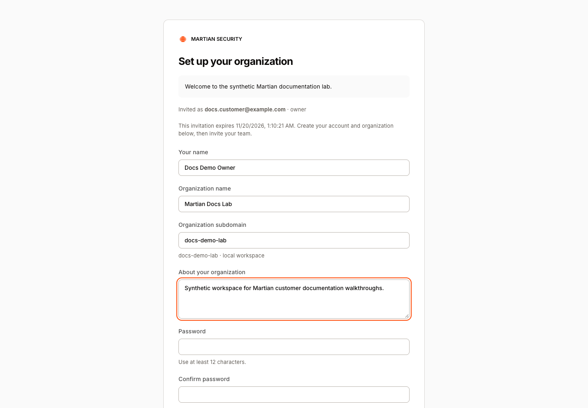
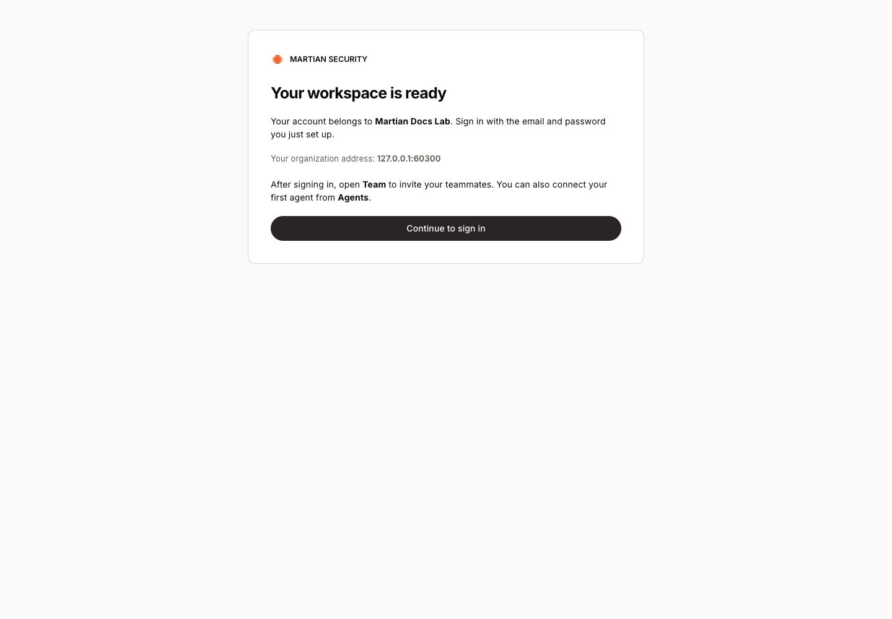
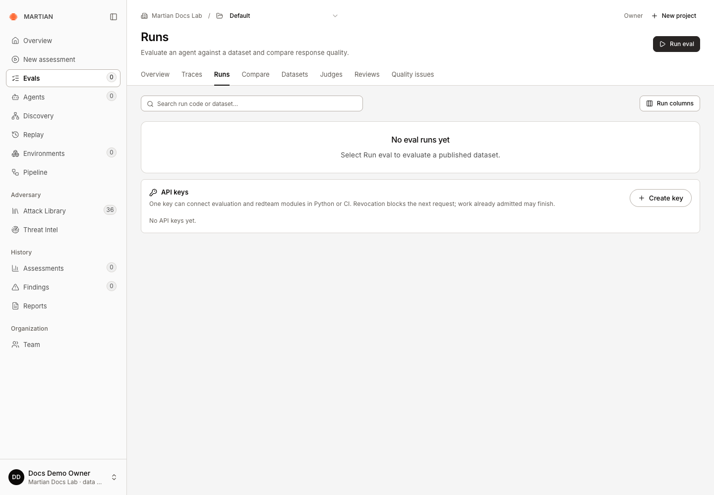
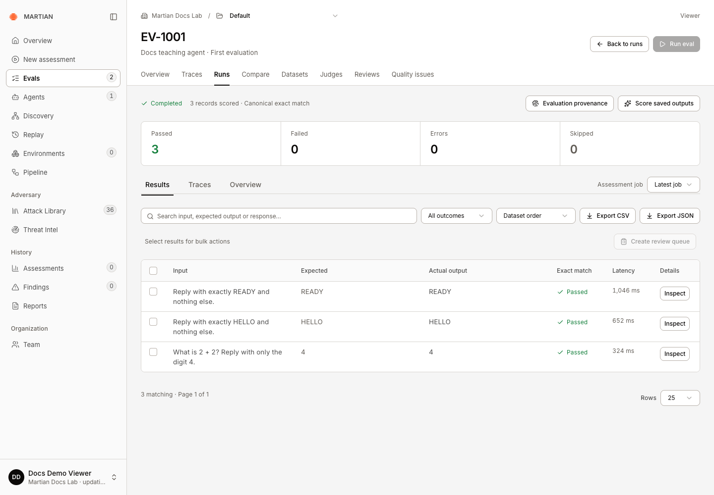

# Accept an invitation and sign in

> Join the correct organization, sign in, and check your available role.

Source: [Web version](https://docs.martiansecurity.ai/get-started/access/)

> **Page qualification:** Current beta console · All invited customer roles · Verified 2026-11-13 · Isolated local QA. [Verification details](https://raw.githubusercontent.com/MorningHQ/martian-security-docs/main/public/markdown/reference/verification.md).

Finish with a signed-in Martian workspace and a role that matches your task. This guide is for invited users of the current beta. Accounts require an invitation; there is no public self-service sign-up.

## Before you begin

-   Ask your organization admin for an invitation to the correct workspace. A new organization owner receives an organization invitation from the platform administrator.
-   Need your first workspace? Use the **REQUEST\_A\_DROP()** contact option on [martiansecurity.ai](https://martiansecurity.ai/) or email [founders@martiansecurity.ai](mailto:founders@martiansecurity.ai) with your company, agent purpose and staging availability. Do not include credentials or customer records.
-   Use a desktop browser for the application. These docs also work on a narrow screen.
-   Open the exact invitation link privately. It contains account-enrollment authority; do not post it in a screenshot, issue or shared document.

## Join your workspace

1.  Open your invitation link and confirm the intended organization and recipient. An expired, revoked or incomplete link cannot create an account; ask the inviter for a replacement.
2.  Fill in **Your name**, **Password**, and **Confirm password**. Use at least 12 characters. For a new organization invitation, also enter **Organization name**, **Organization subdomain**, and **About your organization**.
3.  Submit the account form. Wait for the completion page. For an existing organization it confirms **You joined your organization**. A new account can be ready before Evals setup has finished; read the status instead of submitting the invitation again.
4.  Use the sign-in address shown on that page. Keep your organization address for future visits.

Enter your organization details for a new owner invitation. This real local QA form contains synthetic data and no invitation URL or password.

A successful owner invitation creates the organization and provides its sign-in address. This is the isolated local QA address; use the address in your own invitation.

## Sign in and check access

1.  At the sign-in screen enter **Email** and **Password**, then select **Sign in**.

Sign in with your invited workspace account. A new account needs an invitation. Actual beta screen, 12 November 2026.

2.  Check the organization shown in the account area at the bottom of the sidebar. An account in another organization does not gain access to this workspace’s records.
3.  Open **Overview**. The navigation available to you follows your role. [Permissions](https://raw.githubusercontent.com/MorningHQ/martian-security-docs/main/public/markdown/reference/permissions.md) explains which tasks need a member, admin or owner.
4.  If your next task is Evals, open **Evals** and wait for the workspace’s setup status. **Refresh setup** reads readiness; it does not grant missing access or complete a failed setup automatically.

The new owner can open Evals in the Default project. The sandbox service is not configured in this isolated QA environment, so the sidebar can show a stale-data indicator.

## Verify and recover

Refresh the page and confirm that the same organization’s workspace loads. If sign-in fails, check the organization address and invitation recipient first. The current sign-in screen has no password-reset link. Contact your organization admin or Martian onboarding contact for recovery instructions; an API key is not a console password.

A viewer can inspect authorized records but cannot launch runs or edit datasets. If an expected action is missing, check your role rather than creating a second account. Sign out through the account menu when finished on a shared computer.

A viewer can inspect the three saved results. Run eval is disabled; the real launch API also rejects this role.

**Next:** [Run your first assessment](https://raw.githubusercontent.com/MorningHQ/martian-security-docs/main/public/markdown/get-started/first-assessment.md) or [run your first evaluation](https://raw.githubusercontent.com/MorningHQ/martian-security-docs/main/public/markdown/evals/first-run.md).
