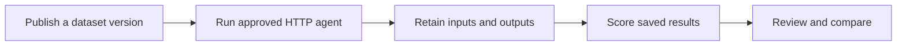

# Red teaming and Evals

> Understand the evidence, records, and workflows before your first run.

Source: [Web version](https://docs.martiansecurity.ai/get-started/concepts/)

> **Page qualification:** Current beta console · All customer roles · Verified 2026-11-13 · Isolated local QA; named HTTP/catalogue walkthrough. [Verification details](https://raw.githubusercontent.com/MorningHQ/martian-security-docs/main/public/markdown/reference/verification.md).

Use this guide to choose the right workflow and recognize its results. It is for every workspace role and the current Martian beta interface.

## Red teaming: look for a security failure

An **assessment** is a bounded attempt to make an authorized agent violate its intended rules. Choose an approved agent, the scope to test, attacker goals and supported tests. Martian records the attempts and the available evidence.

An **endpoint-only** assessment tests the agent’s exposed chat interface. A **sandbox-backed** assessment connects the agent to isolated, synthetic business applications so supported checks can inspect effects such as a changed payment record. The two scopes establish different things: a concerning answer alone does not prove a business side effect.

A **finding** records an observed problem. Read its outcome checks, reproductions, controls and coverage before deciding what it establishes. An incomplete run or an unchecked outcome is not a clean bill of health.

## Evals: measure known cases

A **dataset** holds inputs and expected answers. A published **version** is immutable. An evaluation run calls an approved HTTP agent for selected active records, retains its outputs and records exact-match results.

Additional **scorers** examine saved outputs. A model **judge** adds configured model feedback; a **human review** records a person’s typed answer and explanation. These assessments retain their own identity and do not replace the original exact-match result.

Run the target once for the selected dataset records; additional scoring, reviews and comparisons operate on retained outputs.

## Records you will see

| Term | Meaning |
| --- | --- |
| Organization | Your workspace and access boundary |
| Agent connection | The address, interface and approval used to reach an agent |
| Environment | A saved configuration of synthetic business systems |
| Seed data | Synthetic records used to initialize an environment |
| Trace | A retained record of execution, messages or related evidence |
| Project | An Evals grouping for runs, traces and review work |
| Suite | A versioned set of scoring criteria and thresholds |
| Call gate | An explicitly enrolled SDK control for entry to named model/tool calls |

## Choose your next task

1.  [Get access](https://raw.githubusercontent.com/MorningHQ/martian-security-docs/main/public/markdown/get-started/access.md).
2.  For security testing, [run your first assessment](https://raw.githubusercontent.com/MorningHQ/martian-security-docs/main/public/markdown/get-started/first-assessment.md).
3.  For response quality, [run your first evaluation](https://raw.githubusercontent.com/MorningHQ/martian-security-docs/main/public/markdown/evals/first-run.md).
4.  To automate checks in your own process, [install the SDK](https://raw.githubusercontent.com/MorningHQ/martian-security-docs/main/public/markdown/sdk/install-and-configure.md).

See the [glossary](https://raw.githubusercontent.com/MorningHQ/martian-security-docs/main/public/markdown/reference/glossary.md) for the remaining terms and [supported targets](https://raw.githubusercontent.com/MorningHQ/martian-security-docs/main/public/markdown/reference/supported-targets.md) before choosing an interface.
