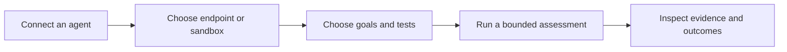

# Martian Security

> Practical customer guides for red teaming, evaluations, and the Martian SDK.

Source: [Web version](https://docs.martiansecurity.ai/)

Find security failures with **red teaming**. Measure response quality with **Evals**. Keep both checks in your development workflow with the **SDK and CI**.

- [Run your first assessment](https://raw.githubusercontent.com/MorningHQ/martian-security-docs/main/public/markdown/get-started/first-assessment.md): Connect an agent, choose a small test, and inspect the evidence.

- [Run your first evaluation](https://raw.githubusercontent.com/MorningHQ/martian-security-docs/main/public/markdown/evals/first-run.md): Use a published dataset to compare expected and actual answers.

- [Integrate the SDK and CI](https://raw.githubusercontent.com/MorningHQ/martian-security-docs/main/public/markdown/sdk/install-and-configure.md): Run local callbacks and record repeatable checks for a tested revision.

## Start with your workspace

Want a local preview first? [Try a free two-record SDK evaluation](https://raw.githubusercontent.com/MorningHQ/martian-security-docs/main/public/markdown/sdk/evaluations.md) without a Martian account or model key.

New to Martian? [Accept your invitation and sign in](https://raw.githubusercontent.com/MorningHQ/martian-security-docs/main/public/markdown/get-started/access.md), then read [the concepts](https://raw.githubusercontent.com/MorningHQ/martian-security-docs/main/public/markdown/get-started/concepts.md). You need an agent connection that you are authorized to test. Each tutorial explains the role, setup and limits before you start.

## Choose the evidence you need

**Red teaming**

Can an attacker steer this agent outside its intended rules?

A bounded assessment with recorded attempts, findings and verification evidence.

**Evals**

Does this version answer a known set of cases correctly?

Dataset-version-pinned results, scores, comparisons and reviews.

**SDK and CI**

Should this tested revision pass my development checks?

Local test results, retained reports and a recorded gate outcome when configured.

The first assessment moves from an approved connection to evidence you can inspect. A finding’s strength depends on the verification actually recorded.

## Explore the product

-   [Agents and connections](https://raw.githubusercontent.com/MorningHQ/martian-security-docs/main/public/markdown/agents/connections.md) — registration, validation and approval.
-   [Environments](https://raw.githubusercontent.com/MorningHQ/martian-security-docs/main/public/markdown/environments/create-and-launch.md) — synthetic seed data and sandbox readiness.
-   [Discovery](https://raw.githubusercontent.com/MorningHQ/martian-security-docs/main/public/markdown/discovery/inventory.md) — inventory and runtime evidence.
-   [Permissions](https://raw.githubusercontent.com/MorningHQ/martian-security-docs/main/public/markdown/reference/permissions.md) and [limits](https://raw.githubusercontent.com/MorningHQ/martian-security-docs/main/public/markdown/reference/limits.md) — understand what your role and environment support.
-   [Troubleshooting](https://raw.githubusercontent.com/MorningHQ/martian-security-docs/main/public/markdown/reference/troubleshooting.md) — recover without starting duplicate work.
-   [Hermes documentation](https://morninghq.github.io/martian-hermes-docs/) — the separate Hermes agent and its operator workflow.

These are beta product guides. The [verification record](https://raw.githubusercontent.com/MorningHQ/martian-security-docs/main/public/markdown/reference/verification.md) identifies observed walkthroughs and any qualification still in progress.
